# Smart Library Management System: Object-Oriented Analysis and Design

| | |
|---|---|
| **Document** | Requirements analysis, architecture, and object-oriented model |
| **System** | Smart Library Management System (`smart-library-mgt`) |
| **Version** | 1.0 (23 November 2026) |
| **Status** | Analysis and design. The full system is not built yet; a partial prototype exists in [`src/`](../src). |

## Contents

1. [Introduction](#1-introduction)
2. [Requirement Analysis](#2-requirement-analysis)
3. [System Architecture Design](#3-system-architecture-design)
4. [Object-Oriented Analysis (OOA)](#4-object-oriented-analysis-ooa)
5. [Data, Functional, and Behavioral Modeling](#5-data-functional-and-behavioral-modeling)
6. [Abstraction to Implementation](#6-abstraction-to-implementation)
7. [Design Principles and Patterns Applied](#7-design-principles-and-patterns-applied)
8. [Traceability Matrix](#8-traceability-matrix)
9. [Assumptions, Open Questions, and Future Work](#9-assumptions-open-questions-and-future-work)
10. [Appendix: Figure Index](#10-appendix-figure-index)

> [!NOTE]
> **How to view the diagrams.** Every diagram is written in [Mermaid](https://mermaid.js.org/), a text-based diagram format. GitHub renders it automatically. In VS Code, install the *Markdown Preview Mermaid Support* extension. To edit a diagram or export it as PNG or SVG, paste the code block into [mermaid.live](https://mermaid.live), or import it into draw.io with *Arrange ▸ Insert ▸ Advanced ▸ Mermaid*.

**UML notation used in the class diagrams**

| Notation | Meaning |
|---|---|
| `+` / `-` / `#` | Public / private / protected member |
| `$` after a member | Static member |
| `*` after a method | Abstract method |
| Solid line, hollow triangle | Inheritance (generalization): "is a" |
| Dashed line, hollow triangle | Interface realization: "implements" |
| Filled diamond | Composition: the part cannot exist without the whole |
| Hollow diamond | Aggregation: the whole holds the part, but the part can exist on its own |
| Solid arrow | Directed association: "knows about" |
| Dashed arrow | Dependency: "uses temporarily" |
| `"1"`, `"0..*"`, `"1..*"` | Multiplicity: exactly one, zero or more, one or more |

---

## 1. Introduction

### 1.1 Purpose

This document analyzes and models a simplified Library Management System (LMS) using Object-Oriented Analysis (OOA) and architectural planning. Each main section answers one question:

| Section | Question answered |
|---|---|
| 2. Requirement Analysis | Who uses the system, and what must it do? |
| 3. System Architecture Design | Which major parts make up the system, and how do they interact? |
| 4. Object-Oriented Analysis | Which objects exist, what do they know and do, and how do they collaborate over time? |
| 5. Data, Functional, and Behavioral Modeling | How is data structured, what does the system do, and how does it behave over time? |
| 6. Abstraction to Implementation | How do the models become code? |

### 1.2 Scope

**In scope**

- Catalog management: book titles and their physical copies.
- Member management: registration, member types (student and teacher), suspension.
- Circulation: issuing (check-out), returning (check-in), and renewing loans.
- Reservations (holds) for titles with no available copy.
- Late-return fines and lost-copy charges.
- Notifications: loan receipts, due-date reminders, overdue notices, and pickup notices for held copies.
- Administration: staff accounts, loan policies, reports, and an audit trail.

**Out of scope**

- Acquisitions and purchasing, inter-library loans, and digital lending (e-books).
- The internals of external services such as the email or SMS provider and the payment processor.
- Hardware integration such as RFID gates or self-checkout kiosks. The design leaves room for these through the presentation layer.

### 1.3 Relationship to the existing prototype

The repository already contains an in-memory TypeScript prototype under [`src/`](../src). It implements a subset of this design:

- Users (`Student`, `Teacher`) created through [`UserFactory`](../src/services/UserFactory.ts).
- Books with an encapsulated copy counter ([`Book.ts`](../src/models/Book.ts)).
- Borrow and return transactions ([`BorrowTransaction.ts`](../src/models/BorrowTransaction.ts)).
- Overdue detection and Observer-based notifications sent at most once ([`LibrarySystem.ts`](../src/services/LibrarySystem.ts), [`NotificationService.ts`](../src/services/NotificationService.ts)).

This document treats the prototype as the **as-is** model and designs the **to-be** model around it. Elements that go beyond the current code are marked **(Proposed)**. Section [6.5](#65-from-prototype-to-target-design-gap-analysis) lists the gaps and an incremental path to close them.

### 1.4 Glossary

| Term | Definition |
|---|---|
| **Book (title)** | A catalog entry that describes a work: ISBN, title, authors, category. One title can have many physical copies. |
| **Book copy (item)** | One physical, barcoded instance of a book. A copy, not a title, is what gets lent. |
| **Member (patron)** | A registered borrower. In this system a member is either a student or a teacher. |
| **Staff** | Librarians and administrators who operate the system. |
| **Loan** | The record that a specific copy was issued to a member on a date, with a due date. The prototype calls it `BorrowTransaction`. |
| **Issue (check-out)** | Lending a copy to a member, which creates a loan. |
| **Return (check-in)** | Receiving a copy back, which closes its loan. |
| **Renewal** | Extending the due date of an active loan. |
| **Reservation (hold)** | A member's request for a title that has no available copy. The next returned copy is held for that member. |
| **Overdue** | Describes an active loan whose due date has passed. |
| **Fine** | A charge for a late return or a lost copy. |
| **Loan policy** | The limits that depend on member type: maximum active loans, loan period, renewals, and fine rates. |
| **Circulation** | The umbrella term for issuing, returning, renewing, and reserving. |

---

## 2. Requirement Analysis

### 2.1 Actors

An actor is a role that interacts with the system from outside it. Primary actors start use cases to reach a goal. Secondary actors are systems or services that the LMS calls, or that trigger it on a schedule.

| Actor | Kind | Description | Main goals |
|---|---|---|---|
| **Guest** | Primary, human | An unregistered visitor using the public catalog. | Find out whether the library has a book and whether a copy is available. |
| **Member** | Primary, human (abstract) | A registered borrower. Inherits everything a guest can do. | Borrow, renew, and reserve books, and track loans, fines, and notifications. |
| **Student** | Specialization of Member | A member with a short loan period and a low loan limit. | As Member. |
| **Teacher** | Specialization of Member | A member with a longer loan period and a higher loan limit. | As Member. |
| **Librarian** | Primary, human | Front-desk staff. | Issue and return copies quickly and correctly, maintain the catalog, and manage member accounts. |
| **Administrator** | Primary, human | Senior staff. Inherits all librarian capabilities. | Configure loan policies, manage staff accounts, and review reports and the audit trail. |
| **Scheduler** | Secondary, time-triggered | The system clock or a cron job. | Run daily jobs: overdue detection, due-date reminders, and hold expiry. |
| **Notification gateway** | Secondary, external system | An email or SMS provider. | Deliver messages to members. |
| **Payment gateway** | Secondary, external system (optional) | An online card or mobile-money processor. | Take online fine payments. |

The human actors form a generalization hierarchy. A specialized actor can do everything its parent can do, plus more.

**Figure 2.1: Actor hierarchy**

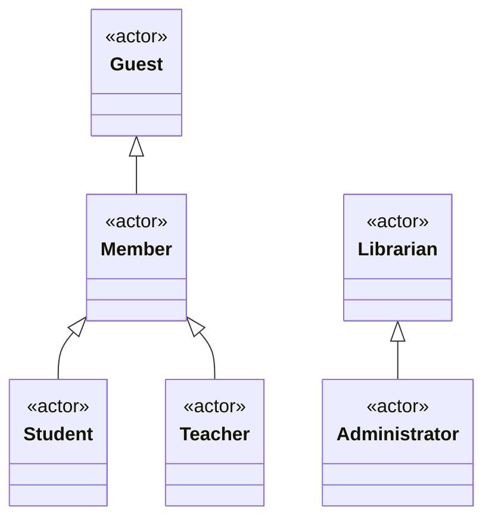

### 2.2 Functional requirements

| ID | Requirement | Actor(s) |
|---|---|---|
| **Catalog** | | |
| FR-01 | The system shall let users search the catalog by title, author, ISBN, or category, alone or in combination. Each result shall show the number of available and total copies. | Guest, Member, Librarian |
| FR-02 | The system shall display a book's details. Staff shall also see each copy's barcode, status, and shelf location. | Guest, Member, Librarian |
| FR-03 | Librarians shall add and update book titles, add copies, and withdraw copies from circulation. | Librarian |
| **Members** | | |
| FR-04 | Librarians shall register members with their type (student or teacher) and contact details, and update those details. | Librarian |
| FR-05 | Librarians shall suspend and reinstate member accounts. | Librarian |
| FR-06 | Members shall view their active loans, due dates, reservations, fines, and notifications. | Member |
| **Circulation** | | |
| FR-07 | Librarians shall issue a copy to an eligible member. The system shall calculate the due date from the member's loan policy. | Librarian |
| FR-08 | The system shall refuse to issue a copy, and state the reason, when the member is not active, has reached the loan limit, has an overdue loan, or owes fines above the allowed threshold. | System |
| FR-09 | Librarians shall check in returned copies. The system shall close the loan, record a fine if the copy is late, and either shelve the copy or hold it for the next reservation. | Librarian |
| FR-10 | Members shall renew an active loan if it is not overdue, the renewal limit is not reached, and no other member has reserved the title. | Member, Librarian |
| **Reservations** | | |
| FR-11 | Members shall reserve a title that has no available copy. Reservations are served first come, first served. | Member |
| FR-12 | When a reserved title is returned, the system shall hold the copy for the next member in the queue for the hold period and notify that member. Uncollected holds shall expire. | System |
| FR-13 | Members shall cancel their own reservations. | Member |
| **Fines** | | |
| FR-14 | The system shall record fines for late returns and lost copies. Librarians shall record payments and waive fines. | System, Librarian |
| **Notifications** | | |
| FR-15 | The system shall notify members of loan receipts, due dates two days ahead, overdue loans (once per loan), and holds ready for pickup. | System |
| FR-16 | The system shall run a daily job that detects overdue loans and expired holds. Librarians can also trigger it manually. | Scheduler, Librarian |
| **Administration** | | |
| FR-17 | Administrators shall create, update, and deactivate staff accounts and assign roles. | Administrator |
| FR-18 | Administrators shall configure loan policies per member type. | Administrator |
| FR-19 | Administrators shall generate reports on current loans, overdue loans, popular titles, fines collected, and inventory. | Administrator |
| **Security** | | |
| FR-20 | Everyone except guests shall authenticate. The system shall restrict actions by role. | All |
| FR-21 | The system shall keep an audit trail of circulation and administrative actions. | System |

### 2.3 Non-functional requirements

| ID | Category | Requirement | Measure |
|---|---|---|---|
| NFR-01 | Performance | Catalog search responds quickly for a mid-sized collection. | Under 1 s at the 95th percentile for 100,000 titles. |
| NFR-02 | Performance | Issuing or returning a copy feels instant at the desk. | Under 2 s end to end, excluding notification delivery. |
| NFR-03 | Data integrity | A copy is on at most one active loan. A title's available-copy count is never negative and never above its total. | Enforced by domain invariants and database constraints inside one transaction. |
| NFR-04 | Security | Passwords are stored as salted hashes, every operation checks the caller's role, and members can read only their own records. | Bcrypt or Argon2 hashing; role check on every API endpoint. |
| NFR-05 | Privacy | Borrowing history is personal data. | Visible only to the member and to staff; anonymized after a configurable retention period. |
| NFR-06 | Usability | Desk staff can complete a check-out or check-in with scans and minimal typing. | At most two scans and one confirmation. |
| NFR-07 | Reliability | A notification failure never blocks circulation. | Messages are queued and retried asynchronously. |
| NFR-08 | Maintainability | Business rules are isolated from the UI and the database. | Layered architecture; at least 80% unit-test coverage of the domain and service layers. |
| NFR-09 | Portability | Storage can change without touching business logic. | All persistence goes through repository interfaces. The in-memory store can be swapped for SQL. |
| NFR-10 | Auditability | Every state change of a loan, copy, fine, or member is traceable. | Each audit entry records who, what, and when. |
| NFR-11 | Testability | Time-dependent logic can be tested deterministically. | Methods accept an explicit date (`asOf`, `now`). The prototype already does this. |

### 2.4 Business rules

> [!IMPORTANT]
> The values below are **design assumptions** that illustrate the rules. Administrators configure them under FR-18. The prototype does not enforce limits yet.

| Rule | Student | Teacher |
|---|---|---|
| BR-01 Maximum active loans | 3 | 10 |
| BR-02 Loan period | 14 days | 30 days |
| BR-03 Maximum renewals per loan | 1 | 3 |
| BR-04 Late fine per day | 0.50 | 0.25 |
| BR-05 Maximum fine per loan | 20.00 | 20.00 |
| BR-06 Unpaid fines that block borrowing | above 5.00 | above 10.00 |
| BR-07 Hold period for a ready reservation | 3 days | 3 days |

Amounts are in the library's local currency and are stored as integer cents to avoid rounding errors.

Additional rules:

- **BR-08** A member with any overdue loan cannot borrow until that loan is returned.
- **BR-09** A loan cannot be renewed if it is overdue, has reached its renewal limit, or the title has a pending reservation.
- **BR-10** A copy on hold can be issued only to the member it is held for.
- **BR-11** A loan is overdue when the current date is after its due date and the copy has not been returned.
- **BR-12** Late fine = days late (rounded up) × daily rate, capped by BR-05. A copy returned on or before its due date has no fine.
- **BR-13** A copy is never deleted while any loan references it. It is *withdrawn* instead, which keeps history intact.
- **BR-14** A member receives at most one overdue notice per loan. The prototype already guarantees this.
- **BR-15** A new renewal sets the due date to the renewal date plus the policy's loan period.

### 2.5 Use cases

The use case diagrams are in [section 4.5](#45-use-case-diagrams).

| ID | Use case | Primary actor(s) | Summary | Priority |
|---|---|---|---|---|
| UC-01 | Search catalog | Guest, Member, Librarian | Find titles by title, author, ISBN, or category and see availability. | Must |
| UC-02 | View book details | Guest, Member, Librarian | See a title's details and its copies' statuses. | Must |
| UC-03 | **Issue book (check-out)** | Librarian | Lend a copy to an eligible member and create a loan. | Must |
| UC-04 | **Return book (check-in)** | Librarian | Close the loan, record any fine, and shelve or hold the copy. | Must |
| UC-05 | Renew loan | Member, Librarian | Extend the due date of an active loan. | Should |
| UC-06 | Reserve book | Member | Join the queue for a title with no available copy. | Should |
| UC-07 | Cancel reservation | Member | Leave a reservation queue. | Could |
| UC-08 | View my account | Member | See loans, due dates, reservations, fines, and notifications. | Must |
| UC-09 | Pay or waive fine | Librarian (Member pays) | Settle an outstanding fine. | Should |
| UC-10 | Manage catalog | Librarian | Add and update titles; add and withdraw copies. | Must |
| UC-11 | Manage members | Librarian | Register, update, suspend, and reinstate members. | Must |
| UC-12 | **Detect overdue loans** | Scheduler | Find overdue loans and notify each borrower once. | Must |
| UC-13 | Expire uncollected holds | Scheduler | Release holds that pass their pickup deadline. | Should |
| UC-14 | Manage staff accounts | Administrator | Create, update, and deactivate staff and assign roles. | Should |
| UC-15 | Configure loan policies | Administrator | Change the limits and rates per member type. | Should |
| UC-16 | Generate reports | Administrator | Produce loan, overdue, inventory, and fine reports. | Should |
| UC-17 | Log in / log out | Member, Librarian, Administrator | Authenticate and end a session. | Must |

Several use cases share steps. These are factored out as **included** use cases: *Verify member eligibility* (in UC-03 and UC-05), *Calculate fine* (in UC-04), and *Send notification* (in UC-03, UC-04, UC-06, UC-12, and UC-13). UC-17 is a precondition for every use case except UC-01 and UC-02.

### 2.6 Use case specifications

#### UC-03 Issue book (check-out)

| Field | Description |
|---|---|
| **Primary actor** | Librarian |
| **Secondary actors** | Notification gateway |
| **Stakeholders and interests** | *Member*: gets the book quickly and knows the correct due date. *Library*: every copy that leaves is tracked against a member. |
| **Preconditions** | The librarian is logged in. The member and the copy exist in the system. |
| **Trigger** | A member brings a copy to the desk. |
| **Main success scenario** | 1. The librarian scans the member's card.<br>2. The system displays the member's status, active loans, and unpaid fines.<br>3. The librarian scans the copy's barcode.<br>4. The system verifies the member's eligibility (BR-01, BR-06, BR-08 and member status). *(include: Verify member eligibility)*<br>5. The system verifies that the copy is *Available*, or is *Reserved* for this member.<br>6. The system marks the copy *Issued*, creates a loan with due date = today + loan period (BR-02), and saves it.<br>7. If the copy was held for this member, the system marks the reservation *Fulfilled*.<br>8. The system shows a receipt with the due date and notifies the member. *(include: Send notification)* |
| **Alternative flows** | **4a.** The member is suspended, at the loan limit, has an overdue loan, or owes fines above the threshold: the system shows the specific reason and no loan is created. The librarian may take a fine payment (UC-09) and retry from step 4.<br>**5a.** The member asked for a title and no copy is available: the system offers to place a reservation. *(extend: UC-06 Reserve book)*<br>**5b.** The copy is held for a different member: the system refuses and shows until when the hold lasts.<br>**5c.** The copy's status is *Lost*, *Under repair*, or *Withdrawn*: the system refuses and flags a data inconsistency for the librarian.<br>**8a.** The notification gateway is down: the loan still succeeds and the message is queued for retry (NFR-07). |
| **Postconditions (success)** | Exactly one active loan exists for the copy. The copy's status is *Issued*. The member's active-loan count went up by one. An audit entry is recorded. |
| **Postconditions (failure)** | No data changes. |
| **Frequency** | Very high: hundreds per day. |
| **Prototype** | `LibrarySystem.borrowBook()` in [`LibrarySystem.ts`](../src/services/LibrarySystem.ts). |

#### UC-04 Return book (check-in)

| Field | Description |
|---|---|
| **Primary actor** | Librarian |
| **Secondary actors** | Notification gateway |
| **Stakeholders and interests** | *Member*: the loan is closed promptly and any fine is correct. *Waiting member*: is told as soon as the copy is held for them. *Library*: availability is accurate. |
| **Preconditions** | The librarian is logged in. |
| **Trigger** | A member returns a copy at the desk or through the drop box. |
| **Main success scenario** | 1. The librarian scans the copy's barcode.<br>2. The system finds the active loan for the copy.<br>3. The system records the return date and closes the loan. The copy becomes *Returned*.<br>4. The system calculates the days late and, if there are any, records a fine (BR-12). *(include: Calculate fine)*<br>5. The librarian inspects the copy and confirms that it is in good condition.<br>6. The system checks the title's reservation queue.<br>7. No reservation is pending, so the copy becomes *Available* and goes back on the shelf.<br>8. The system shows a return receipt, including any fine. |
| **Alternative flows** | **2a.** No active loan exists for the barcode: the system warns that the copy is already checked in and the use case ends.<br>**4a.** A fine was recorded and the member wants to pay now. *(extend: UC-09 Pay fine)*<br>**5a.** The copy is damaged: the librarian marks it *Under repair*. The reservation queue is not served from this copy.<br>**7a.** A reservation is pending: the copy becomes *Reserved* for the next member, the hold expires in 3 days (BR-07), and that member is notified. *(include: Send notification)* |
| **Postconditions (success)** | The loan has a return date. The copy is *Available*, *Reserved*, or *Under repair*. A fine exists if the copy was late. An audit entry is recorded. |
| **Frequency** | Very high. |
| **Prototype** | `LibrarySystem.returnBook()` (no fines or reservations yet). |

#### UC-01 Search catalog (brief)

- **Actors:** Guest, Member, Librarian.
- **Main flow:** (1) The user enters one or more criteria: title, author, ISBN, or category. (2) The system checks that at least one criterion is present. (3) The system finds titles that match all given criteria, ignoring case. (4) The system lists each match with its authors and available/total copies. (5) The user may open a result (UC-02).
- **Alternatives:** No criteria given: the system asks for at least one. No results: the system suggests broadening the search.

#### UC-12 Detect overdue loans (brief)

- **Actor:** Scheduler, daily at 00:05. A librarian can also run it manually.
- **Main flow:** (1) The system loads all active loans. (2) For each loan whose due date has passed, the loan is treated as *Overdue*. (3) If the borrower has not been told about this loan yet, the system sends an overdue notice and records that it did (BR-14). (4) The system produces an overdue list for librarians.
- **Postcondition:** Every overdue loan has caused exactly one overdue notice.
- **Prototype:** `LibrarySystem.checkOverdueTransactions(asOf)` with `BorrowTransaction.markOverdueNotificationSent()`. See [Figure 4.11](#sd-4-detect-overdue-loans-as-implemented-in-the-prototype).

---

## 3. System Architecture Design

### 3.1 Architectural style

The system uses a **layered architecture** with a **domain model** at its center, deployed as a single application (a modular monolith).

```text
Presentation  →  API / Controllers  →  Business logic (services)  →  Domain model
                                                  │
                                                  ▼
                                    Data access (repositories)  →  Database
```

Why this style fits:

- **It matches the problem's natural split.** User interfaces, business rules, and storage change for different reasons and at different rates.
- **Each layer can be tested on its own.** Domain classes are plain TypeScript with no UI or database code (NFR-08).
- **Storage can be swapped.** Services depend on repository interfaces, not on a specific database (NFR-09). The prototype's in-memory `Map`s become one implementation.
- **It is right-sized.** One library with modest traffic does not need microservices, which would add deployment and consistency costs without benefit.

**Dependency rule:** each layer calls only the layer directly below it. The domain model depends on nothing else. The data access layer implements interfaces that the service layer defines (dependency inversion), so business logic never imports database code.

### 3.2 Major components

| Layer | Component | Responsibility | In the prototype |
|---|---|---|---|
| **Presentation** | Member portal (web/mobile) | Search, view account, renew, reserve. | (Proposed) |
| | Librarian desk app | Scan cards and barcodes, issue and return, manage the catalog and members. | (Proposed) |
| | Admin console | Staff accounts, loan policies, reports. | (Proposed) |
| | Console demo | A scripted, randomized scenario. | [`src/index.ts`](../src/index.ts) |
| **API** | REST controllers | Convert HTTP requests into service calls, validate input, and map domain errors to HTTP status codes. | (Proposed) |
| | Auth middleware | Authenticate the caller's token and enforce role-based access. | (Proposed) |
| **Business logic** | `CirculationService` | Issue, return, and renew; check eligibility; detect overdue loans. | `LibrarySystem.borrowBook`, `returnBook`, `checkOverdueTransactions` |
| | `CatalogService` | Search; add and update titles; add and withdraw copies. | `LibrarySystem.addBook`, `getBooks` |
| | `MemberService` | Register, update, suspend, and reinstate members. | `UserFactory`, `LibrarySystem.addUser` |
| | `ReservationService` | Queue reservations, hold copies, expire holds. | (Proposed) |
| | `FineService` | Record, collect, and waive fines. | (Proposed) |
| | `NotificationService` | Create notifications and deliver them to subscribers. | [`NotificationService`](../src/services/NotificationService.ts) |
| | `ReportService` | Read-only aggregate queries. | (Proposed) |
| | `AuthService` | Log in, hash passwords, issue tokens. | (Proposed) |
| **Domain model** | Entities and value objects | `Book`, `BookCopy`, `Member`, `Loan`, `Reservation`, `Fine`, `LoanPolicy`. They protect their own invariants. | [`src/models/`](../src/models) |
| **Data access** | Repositories | Load and save domain objects; run queries. | `Map` fields inside `LibrarySystem` |
| | Unit of work | Run one use case inside one database transaction. | (Proposed) |
| **Infrastructure** | Database | Durable storage, for example PostgreSQL or SQLite. | In memory |
| | Notification gateway adapter | Deliver email or SMS, with retry. | `User.update()` stores messages in memory |
| | Scheduler | Run the daily overdue and hold-expiry jobs. | Called manually |
| | Audit log | An append-only record of actions. | (Proposed) |

### 3.3 High-level architecture diagram

**Figure 3.1: Layered architecture**

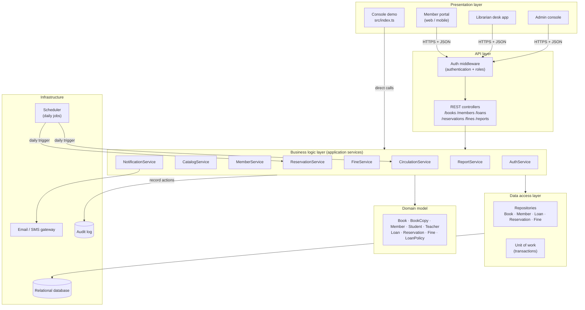

### 3.4 Interactions inside the business layer

**Figure 3.2: Business-layer component interactions**

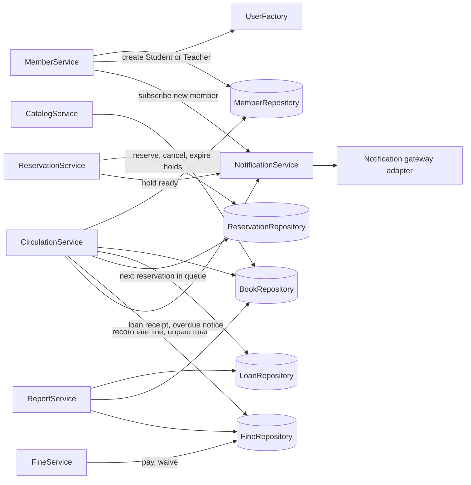

`CirculationService` is the busiest component because circulation use cases touch members, copies, loans, reservations, and fines at once. A return, for example, closes a loan, records a fine, and readies a reservation in one transaction, so the service works with those repositories directly. It coordinates the other parts but holds no business rules of its own: each rule lives in the domain object that owns the data. `ReservationService` and `FineService` handle the use cases that start with a reservation or a fine (UC-06, UC-07, UC-09, UC-13).

### 3.5 Walkthrough: one request through the layers

How *Issue book* (UC-03) travels through the architecture:

1. The librarian scans a member card and a copy barcode in the **desk app**, which sends `POST /api/loans` with `{ memberId, barcode }`.
2. **Auth middleware** validates the token and checks that the caller's role is Librarian or Administrator.
3. **`LoanController`** validates the request body and calls `CirculationService.issueBook(memberId, barcode)`.
4. **`CirculationService`** starts a unit of work and loads the member, the copy, the member's active loans, and their unpaid fine total through **repositories**.
5. **Domain objects** apply the rules: `member.checkEligibility(...)`, `copy.issue(memberId)`, and `new Loan(...)`, which calculates the due date from the policy.
6. The service saves the changes and commits. If any step throws, the transaction rolls back and nothing changes (NFR-03).
7. The service asks **`NotificationService`** to send a loan receipt. Delivery through the gateway is asynchronous (NFR-07).
8. The controller returns `201 Created` with the loan. The desk app shows the due date.

### 3.6 Cross-cutting concerns

| Concern | Approach |
|---|---|
| **Authentication and authorization** | Token-based login through `AuthService`. Middleware maps roles to permissions: a Member can act only on their own loans, a Librarian can run circulation and catalog operations, and an Administrator can do everything. |
| **Validation** | Two levels. Controllers check the request shape (required fields, formats). Domain constructors and methods enforce business invariants, as the prototype already does. |
| **Error handling** | Domain code throws descriptive errors. Controllers map them to HTTP codes: not found → 404, rule violation → 409, bad input → 400. |
| **Transactions** | One use case runs in one unit of work. |
| **Time** | Services accept a `now` or `asOf` argument, or a `Clock` interface, so tests can control time (NFR-11). |
| **Auditing** | Services append `{ actor, action, entity, timestamp }` records to the audit log after each successful command. |
| **Configuration** | Loan policies live in the database (FR-18), not in code. The values in BR-01 to BR-07 are defaults. |

### 3.7 Deployment view

**Figure 3.3: Deployment view**

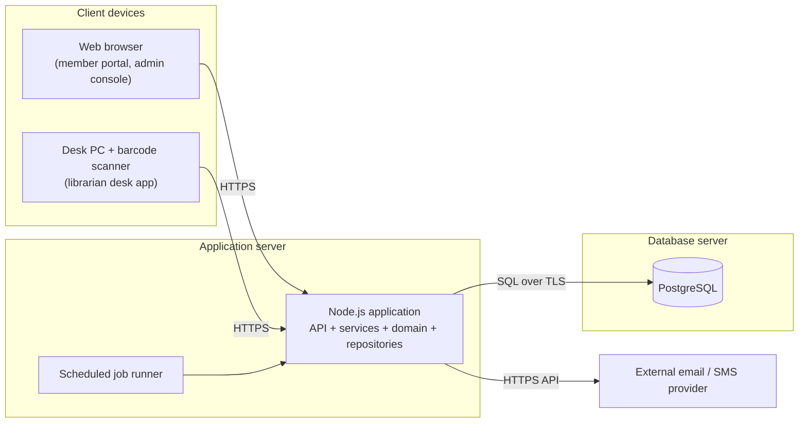

### 3.8 Where the prototype fits

| Layer | Prototype element |
|---|---|
| Presentation | [`src/index.ts`](../src/index.ts), a console scenario |
| Business logic (facade) | [`LibrarySystem`](../src/services/LibrarySystem.ts) (Singleton), [`NotificationService`](../src/services/NotificationService.ts), [`UserFactory`](../src/services/UserFactory.ts) |
| Domain model | [`Book`](../src/models/Book.ts), [`BorrowTransaction`](../src/models/BorrowTransaction.ts), [`User`, `Student`, `Teacher`](../src/models/User.ts), [`Notification`](../src/models/Notification.ts) |
| Data access | Private `Map<string, …>` fields in `LibrarySystem`, which combine service and storage roles |

The main architectural step from prototype to target design is to pull those `Map`s out into repository classes behind interfaces. Section 6.5 describes it.

---

## 4. Object-Oriented Analysis (OOA)

### 4.1 Identifying classes from the requirements

Classes were found with **noun and verb analysis** of the requirements (section 2.2) and use cases (section 2.5). Nouns are candidate classes or attributes. Verbs are candidate methods. Each candidate was kept only if it has its own identity, data, *and* behavior. Otherwise it became an attribute or was rejected.

**Nouns to classes**

| Noun in the requirements | Decision | Reason |
|---|---|---|
| book, title | **Class `Book`** | Has identity (id, ISBN), data, and behavior (availability, search matching). |
| copy, item, barcode | **Class `BookCopy`**, with `barcode` as an attribute | Each physical item has its own lifecycle (Figure 4.12), separate from the title. |
| author, category | Attributes of `Book` | Little behavior of their own in this scope. They still get their own tables in the data model (section 5.1) for normalization. |
| member, student, teacher | **Abstract class `Member`** with subclasses **`Student`** and **`Teacher`** | They share responsibilities and differ only in their loan rules. |
| librarian, administrator | **Classes `Librarian`** and **`Administrator`** | Staff need an identity for authorization and the audit trail. |
| user | **Abstract class `User`** | Holds identity fields and notification handling shared by members and staff. Already in the prototype. |
| loan, borrowing, transaction | **Class `Loan`** (prototype: `BorrowTransaction`) | The central record linking a member and a copy over time. It is an *association class*. |
| due date, return date, renewal count | Attributes of `Loan` | Plain values with no identity. |
| reservation, hold, queue | **Class `Reservation`** | Has its own lifecycle (Figure 5.7). The queue is the set of pending reservations ordered by creation time. |
| fine, payment | **Class `Fine`**; payment is the attributes `status` and `settledAt` | A fine is created, paid, or waived. |
| loan limit, loan period, fine rate | **Interface `LoanPolicy`** with one implementation per member type | The rules vary by member type. This is the Strategy pattern. |
| notification, message, reminder | **`Notification`** value object; **`NotificationService`** | Already in the prototype (Observer pattern). |
| search criteria | **`SearchCriteria`** value object | Groups the optional search fields. |
| shelf | Attribute `shelfLocation` of `BookCopy` | No behavior of its own. |
| report | Rejected as an entity | Derived data that `ReportService` computes on demand. |
| system, database, screen, desk | Rejected | These are implementation or UI concepts, not domain concepts. |

**Verbs to methods.** Each operation goes to the class that owns the data it needs (the *information expert* principle).

| Verb in the requirements | Method | Owner and reason |
|---|---|---|
| search the catalog | `search(criteria)` | `CatalogService` and `BookRepository` work across many books. `Book.matches(criteria)` tests one book. |
| check eligibility | `checkEligibility(facts)` | `Member` owns its status and loan policy. |
| issue a copy | `issueBook(memberId, barcode)` and `BookCopy.issue(memberId)` | The service coordinates. The copy guards its own status. |
| compute the due date | `Loan` constructor and `Loan.renew()` | The loan owns its dates. The policy supplies the loan period. |
| return a copy | `returnBook(barcode)`, `Loan.close(date)`, `BookCopy.checkIn()` | Each object updates its own state. |
| renew a loan | `Loan.renew(policy, asOf, titleReserved)` | The loan knows its renewal count and due date. |
| calculate a fine | `Loan.lateFeeCents(policy, asOf)` | The loan knows the dates. The policy knows the rate and cap. |
| reserve, cancel | `ReservationService.reserve()`, `Reservation.cancel()` | The reservation owns its status. |
| hold for a member | `BookCopy.holdFor(memberId)`, `Reservation.markReady()` | Both objects change state together. |
| notify | `NotificationService.notify()` and `User.update()` | Observer pattern, as in the prototype. |
| suspend, reinstate | `Member.suspend()`, `Member.reinstate()` | The member owns its account status. |
| mark lost or damaged | `BookCopy.reportLost()`, `BookCopy.sendForRepair()` | The copy owns its physical status. |

### 4.2 Class responsibilities (CRC cards)

Class-Responsibility-Collaborator (CRC) cards summarize what each class *knows*, what it *does*, and which classes it works with. Following the single responsibility principle, each class has one reason to change.

| Class | Knows | Does | Collaborators |
|---|---|---|---|
| `User` (abstract) | id, name, email, role, received notifications | Receives notifications (`update`) | `Notification`, `NotificationService` |
| `Member` (abstract) | account status, loan policy | Decides whether it may borrow; is suspended or reinstated | `LoanPolicy`, `Loan`, `Fine` |
| `Student`, `Teacher` | their specific policy | Supply the right `LoanPolicy` | `StudentLoanPolicy`, `TeacherLoanPolicy` |
| `Librarian`, `Administrator` | staff number, permissions | Authorize staff operations | `AuthService` |
| `LoanPolicy` | loan limit, period, renewals, fine rate, fine caps | Nothing: pure configuration | none |
| `Book` | id, ISBN, title, authors, category, its copies | Adds copies, counts available copies, matches search criteria | `BookCopy`, `SearchCriteria` |
| `BookCopy` | barcode, shelf, status, the member it is held for | Changes status only through legal transitions | `Book`, `Loan`, `Reservation` |
| `Loan` | member, copy, issue date, due date, close date, renewals | Reports its status at a date, renews, closes, calculates the late fee, records that an overdue notice was sent | `LoanPolicy` |
| `Reservation` | member, title, created date, status, held copy, expiry | Becomes ready, fulfilled, cancelled, or expired | `Member`, `Book`, `BookCopy` |
| `Fine` | loan, member, amount, status | Is paid or waived | `Loan`, `Member` |
| `CirculationService` | its repositories and notifier | Orchestrates issue, return, renew, and overdue detection | Repositories, `Notifier` |
| `CatalogService` | book repository | Searches; adds titles and copies | `BookRepository` |
| `NotificationService` | subscribers by user id | Creates notifications and delivers them | `NotificationObserver` |
| Repositories | stored objects | Save, find, and query objects | Database |

### 4.3 Class diagrams

The model is shown in four diagrams so that each stays readable: an overview of all relationships, then three detailed views.

**Figure 4.1: Domain overview (relationships only)**

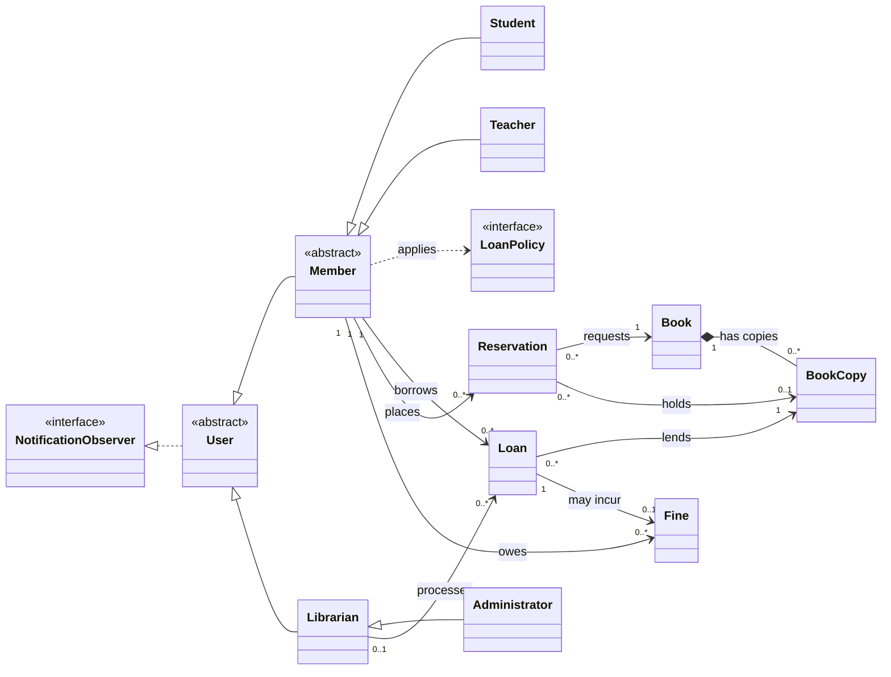

**Figure 4.2: Users, members, and loan policies**

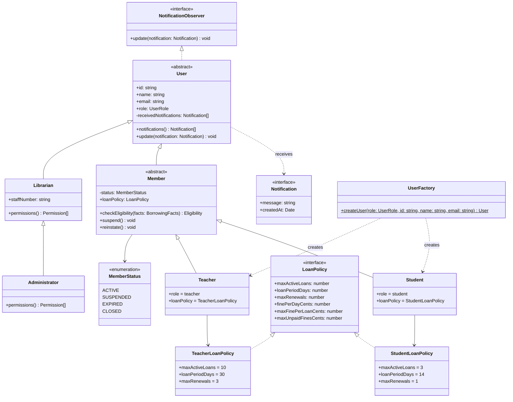

**Figure 4.3: Catalog and circulation**

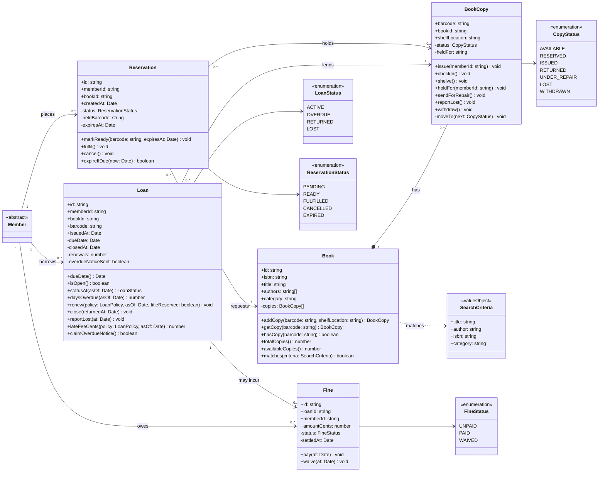

**Figure 4.4: Services and data access**

```mermaid
classDiagram
    direction TB
    class LibrarySystem {
        <<singleton>>
        -instance: LibrarySystem$
        +getInstance() LibrarySystem$
        +circulation: CirculationService
        +catalog: CatalogService
        +members: MemberService
        +reservations: ReservationService
    }
    class CirculationService {
        -deps: CirculationDependencies
        +issueBook(memberId: string, barcode: string, now: Date) Loan
        +returnBook(barcode: string, now: Date, condition: CopyCondition) ReturnReceipt
        +renewLoan(loanId: string, now: Date) Loan
        +checkOverdueLoans(asOf: Date) Loan[]
    }
    class CatalogService {
        +search(criteria: SearchCriteria) Book[]
        +addBook(book: Book) void
        +addCopy(bookId: string, barcode: string, shelfLocation: string) BookCopy
        +withdrawCopy(barcode: string) void
    }
    class MemberService {
        +register(role: UserRole, id: string, name: string, email: string) Member
        +suspend(memberId: string) void
        +reinstate(memberId: string) void
    }
    class ReservationService {
        +reserve(memberId: string, bookId: string, now: Date) Reservation
        +cancel(reservationId: string) void
        +expireHolds(now: Date) Reservation[]
    }
    class FineService {
        +pay(fineId: string, at: Date) void
        +waive(fineId: string, at: Date) void
    }
    class Notifier {
        <<interface>>
        +notify(userId: string, message: string) void
    }
    class NotificationService {
        -observers: Map
        +subscribe(userId: string, observer: NotificationObserver) void
        +notify(userId: string, message: string) void
    }
    class UserFactory {
        +createUser(role: UserRole, id: string, name: string, email: string) User$
    }
    class BookRepository {
        <<interface>>
        +findById(bookId: string) Book
        +findByBarcode(barcode: string) Book
        +search(criteria: SearchCriteria) Book[]
        +save(book: Book) void
    }
    class MemberRepository {
        <<interface>>
        +findById(memberId: string) Member
        +save(member: Member) void
    }
    class LoanRepository {
        <<interface>>
        +nextId() string
        +findById(loanId: string) Loan
        +findActiveByMember(memberId: string) Loan[]
        +findActiveByBarcode(barcode: string) Loan
        +findAllActive() Loan[]
        +save(loan: Loan) void
    }
    class ReservationRepository {
        <<interface>>
        +nextId() string
        +nextPendingFor(bookId: string) Reservation
        +findReadyByBarcode(barcode: string) Reservation
        +hasPendingFor(bookId: string) boolean
        +save(reservation: Reservation) void
    }
    class FineRepository {
        <<interface>>
        +nextId() string
        +unpaidTotalFor(memberId: string) number
        +save(fine: Fine) void
    }
    class InMemoryLoanRepository {
        -loans: Map
        -sequence: number
    }
    class SqlLoanRepository {
        -db: DatabaseConnection
    }
    LibrarySystem o-- CirculationService
    LibrarySystem o-- CatalogService
    LibrarySystem o-- MemberService
    LibrarySystem o-- ReservationService
    CirculationService --> BookRepository
    CirculationService --> MemberRepository
    CirculationService --> LoanRepository
    CirculationService --> ReservationRepository
    CirculationService --> FineRepository
    CirculationService --> Notifier
    CatalogService --> BookRepository
    MemberService --> MemberRepository
    MemberService ..> UserFactory : uses
    MemberService --> NotificationService : subscribes new members
    ReservationService --> ReservationRepository
    ReservationService --> Notifier
    FineService --> FineRepository
    Notifier <|.. NotificationService
    LoanRepository <|.. InMemoryLoanRepository
    LoanRepository <|.. SqlLoanRepository
```

Only the loan repository's implementations are drawn. Every other repository interface has the same pair: an in-memory version for tests and the demo, and a SQL version for production.

### 4.4 Relationships explained

| Relationship | Kind | Multiplicity | Rationale |
|---|---|---|---|
| `Book` ◆— `BookCopy` | Composition | 1 to 0..* | A copy cannot exist without its title. A new title may have no copies yet. |
| `Member` → `Loan` | Association | 1 to 0..* | Every loan belongs to exactly one member. A member has many loans over time. |
| `Loan` → `BookCopy` | Association | 0..* to 1 | A copy appears in many loans over its life, but in **at most one active loan** at a time (NFR-03). `Loan` is the association class between `Member` and `BookCopy`. |
| `Member` → `Reservation` → `Book` | Associations | 1 to 0..*, and 0..* to 1 | Members reserve a *title*, not a specific copy. Any returned copy can serve the queue. |
| `Reservation` → `BookCopy` | Association | 0..* to 0..1 | The held copy is known only once the reservation is *Ready*. |
| `Loan` → `Fine` | Association | 1 to 0..1 | A loan incurs at most one fine: late or lost. |
| `Member` ⇢ `LoanPolicy` | Dependency (Strategy) | n/a | Each `Member` subclass supplies its own policy. New member types need no change to circulation code. |
| `Student`, `Teacher` —▷ `Member` —▷ `User` | Generalization | n/a | Shared identity and notification behavior; specialized loan rules. |
| `User` ⇢▷ `NotificationObserver` | Realization | n/a | Any user can receive notifications (Observer pattern). |
| Services → repository interfaces | Association through interfaces | n/a | Dependency inversion: business logic depends on abstractions, never on a database. |

### 4.5 Use case diagrams

Mermaid has no dedicated use case notation, so these diagrams follow UML conventions inside a flowchart. Rounded ovals are use cases, boxes marked «actor» are actors, the frame is the system boundary, and dotted arrows are «include» and «extend» relationships.

**Figure 4.5: Member-facing use cases**

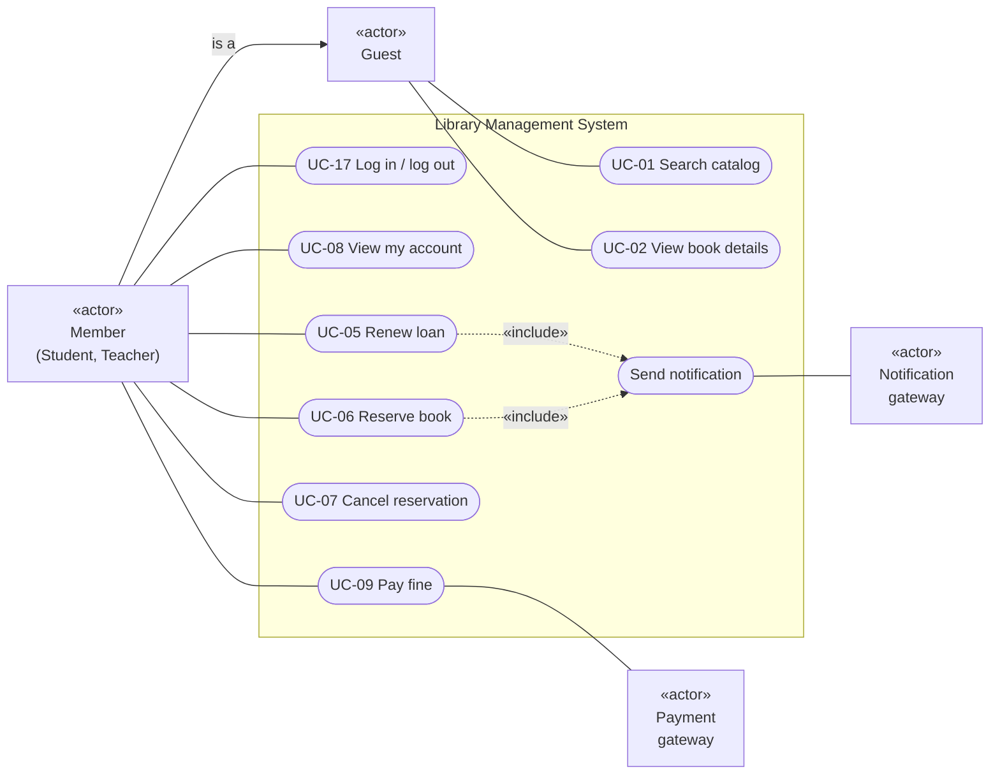

**Figure 4.6: Staff and administration use cases**

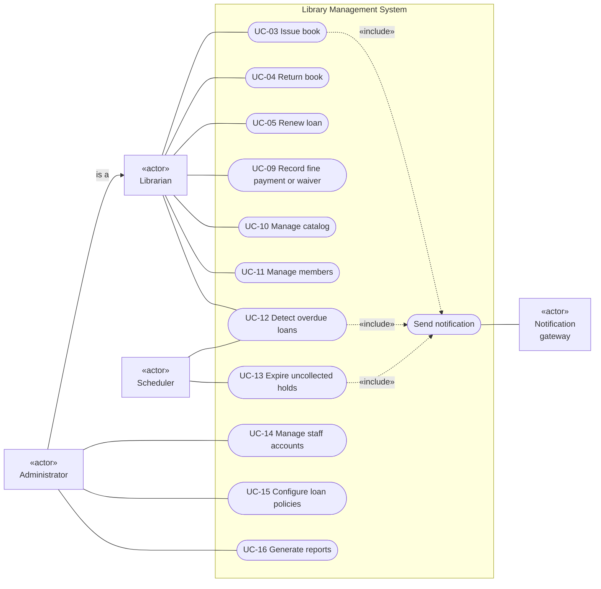

**Figure 4.7: Circulation use cases in detail («include» and «extend»)**

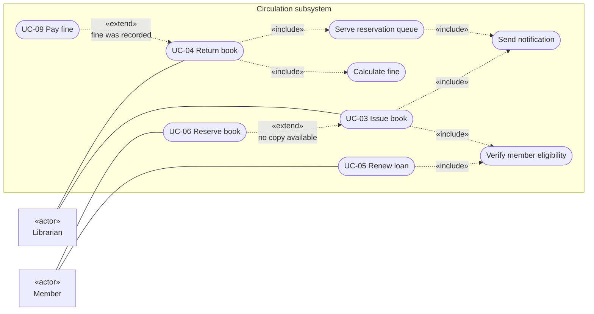

How to read Figure 4.7:

- **«include»** points from a base use case to a step it *always* performs. Issuing a book always verifies eligibility.
- **«extend»** points from an optional use case to the base use case it *sometimes* extends, under the condition on the arrow. *Reserve book* extends *Issue book* at the "no copy available" extension point (UC-03, alternative flow 5a). *Pay fine* extends *Return book* when a fine was recorded (UC-04, alternative flow 4a).

### 4.6 Sequence diagrams

The first three sequence diagrams show the **target design**. The fourth shows the overdue check **as the prototype implements it today**.

#### SD-1: Issue book (UC-03)

**Figure 4.8: Issue book**

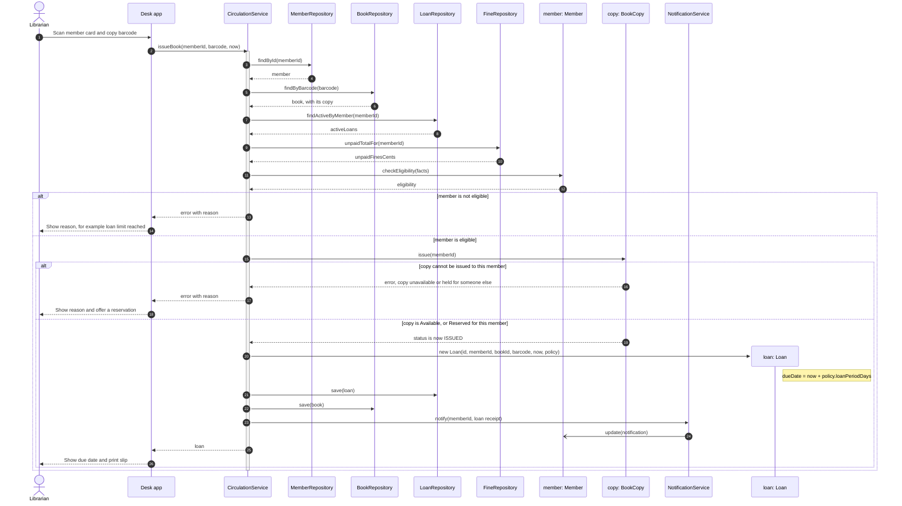

Design notes:

- The service *gathers facts* (active loans, unpaid fines) and the member *applies the rules*. Eligibility rules stay in the domain, and database access stays in the service and repositories.
- `BookCopy.issue()` is the single place that decides whether a copy can be lent. It rejects a copy held for another member (BR-10) and any illegal status change.
- The notification step is fire-and-forget (`-)`), so a slow email provider cannot block the desk (NFR-07).

#### SD-2: Return book (UC-04)

**Figure 4.9: Return book**

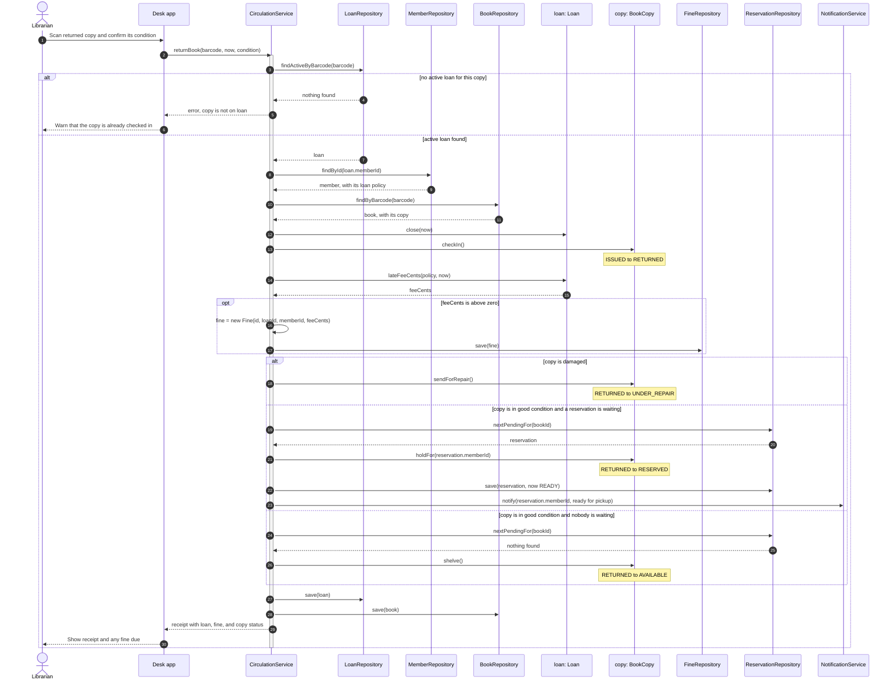

#### SD-3: Search catalog (UC-01)

**Figure 4.10: Search catalog**

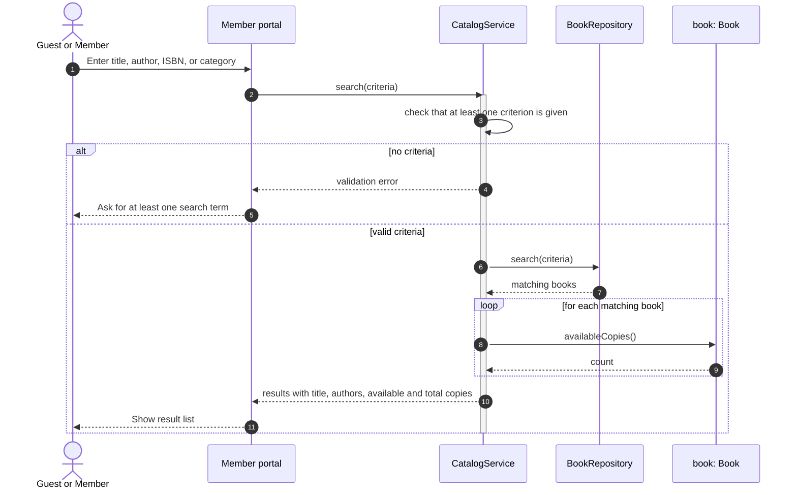

#### SD-4: Detect overdue loans (as implemented in the prototype)

This diagram uses the prototype's real class and method names from [`LibrarySystem.ts`](../src/services/LibrarySystem.ts) and [`BorrowTransaction.ts`](../src/models/BorrowTransaction.ts).

**Figure 4.11: Detect overdue loans (prototype)**

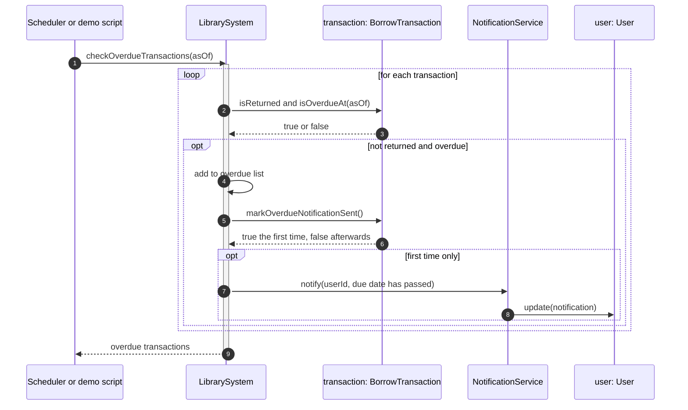

`markOverdueNotificationSent()` acts as a guard: it returns `true` only once per transaction. Running the job every day therefore never sends a member a duplicate notice (BR-14).

### 4.7 State diagrams for the Book object

A library has two notions of "book", and each has its own state model:

1. **A physical copy** (`BookCopy`) moves through a full lifecycle: on the shelf, on loan, back at the desk, on hold, under repair, lost, withdrawn. This is the main state diagram (Figure 4.12). It refines the assignment's *Available → Issued → Returned* cycle.
2. **A title** (`Book`) is available while at least one copy is available. This is how the prototype models a book today, with a copy counter (Figure 4.13).

**Figure 4.12: BookCopy lifecycle (target design)**

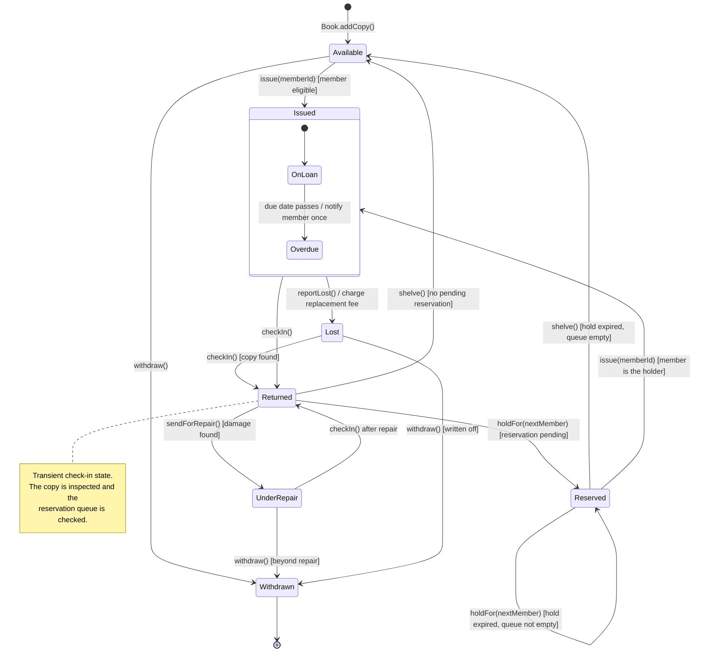

Labels follow the UML form `event [guard] / action`. *OnLoan* and *Overdue* are sub-states of *Issued*. The copy itself only records `ISSUED`; whether the loan is overdue is derived from the active `Loan`'s due date (see Figure 5.5). This keeps each fact in exactly one object.

**State transition table for `BookCopy`**

| From | Event (method) | Guard | Action | To |
|---|---|---|---|---|
| (new) | `Book.addCopy()` | Barcode is unique | Record the shelf location | Available |
| Available | `issue(memberId)` | Member is eligible (BR-01, BR-06, BR-08) | Create a `Loan` with the due date from the policy | Issued (OnLoan) |
| Available | `withdraw()` | — | Remove from circulation | Withdrawn |
| Issued (OnLoan) | due date passes (time event) | Not returned | Send the overdue notice once (BR-14) | Issued (Overdue) |
| Issued | `checkIn()` | An active loan exists | Close the loan, calculate any fine | Returned |
| Issued | `reportLost()` | — | Close the loan as lost, charge a replacement fee | Lost |
| Returned | `shelve()` | Good condition, no pending reservation | — | Available |
| Returned | `holdFor(memberId)` | Good condition, reservation pending | Mark the reservation *Ready*, set its expiry (BR-07), notify the member | Reserved |
| Returned | `sendForRepair()` | Damage found | — | UnderRepair |
| Reserved | `issue(memberId)` | `memberId` is the holder (BR-10) | Fulfil the reservation, create a `Loan` | Issued |
| Reserved | `holdFor(nextMember)` | Hold expired, another reservation pending | Expire the old reservation, notify the next member | Reserved |
| Reserved | `shelve()` | Hold expired, queue empty | Expire the reservation | Available |
| UnderRepair | `checkIn()` | Repair finished | — | Returned |
| UnderRepair, Lost | `withdraw()` | Beyond repair or written off | — | Withdrawn |
| Lost | `checkIn()` | The copy was found | Adjust the replacement fee per policy | Returned |

Any event not listed for a state is **illegal** and is rejected with an error. For example, `issue()` on an *Issued* copy fails. Section 6.3.2 implements exactly this table.

**Figure 4.13: Book (title) availability, as implemented in the prototype**

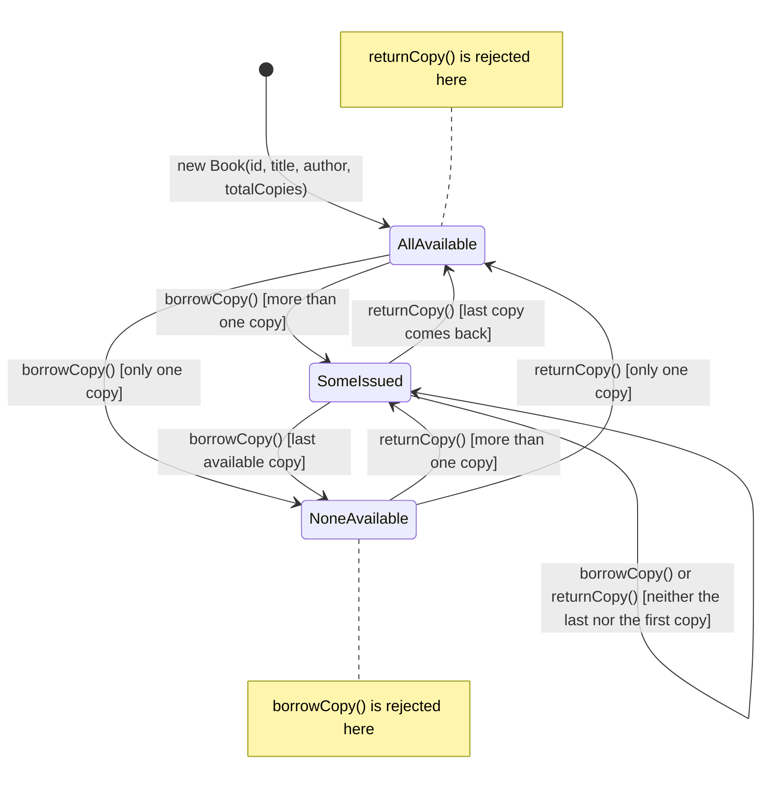

In [`Book.ts`](../src/models/Book.ts), these states are not stored. They are implied by the private `copiesAvailable` counter, which `borrowCopy()` and `returnCopy()` keep between 0 and `totalCopies`. The two rejected events match the errors the prototype throws: *"No copies of … are available"* and *"All copies of … are already in the library"*.

---

## 5. Data, Functional, and Behavioral Modeling

The three models look at the same system from three angles:

| Model | Question | Main artifacts |
|---|---|---|
| **Data model** | How is information structured and kept consistent? | Entity-relationship diagram, data dictionary, integrity constraints, DDL |
| **Functional model** | What does the system do with that information? | Context diagram, level-1 data flow diagram, functional decomposition, process specifications |
| **Behavioral model** | How does the system respond to events over time? | Event table, state machines, activity diagrams (plus the sequence diagrams in section 4.6) |

### 5.1 Data model

#### Entity-relationship diagram

**Figure 5.1: Logical data model**

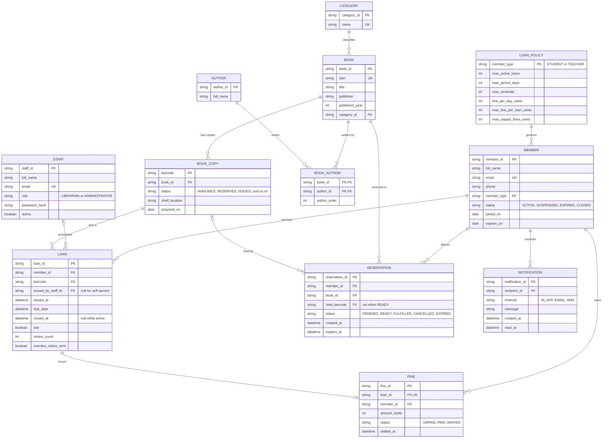

The model is in third normal form. Authors and categories are separate tables, so a correction to an author's name happens in one place. Derived values such as available copies, overdue status, and eligibility are **not stored**. They are computed from the data, so they can never go stale.

#### Data dictionary (core tables)

**`BOOK_COPY`**: one row per physical item.

| Column | Type | Key | Null | Rule |
|---|---|---|---|---|
| `barcode` | VARCHAR(32) | PK | No | Printed on the item's label; unique. |
| `book_id` | VARCHAR(36) | FK → BOOK | No | The title this copy belongs to. Delete is restricted (BR-13). |
| `status` | VARCHAR(16) | | No | One of `AVAILABLE`, `RESERVED`, `ISSUED`, `RETURNED`, `UNDER_REPAIR`, `LOST`, `WITHDRAWN`. Default `AVAILABLE`. |
| `shelf_location` | VARCHAR(32) | | No | For example `4B-12`. |
| `acquired_on` | DATE | | No | Accession date. |

**`LOAN`**: one row per check-out.

| Column | Type | Key | Null | Rule |
|---|---|---|---|---|
| `loan_id` | VARCHAR(36) | PK | No | Generated identifier. |
| `member_id` | VARCHAR(36) | FK → MEMBER | No | The borrower. |
| `barcode` | VARCHAR(32) | FK → BOOK_COPY | No | The copy lent. At most one open loan per barcode (IC-02). |
| `issued_by_staff_id` | VARCHAR(36) | FK → STAFF | Yes | Null for self-service check-out. |
| `issued_at` | TIMESTAMPTZ | | No | When the copy was issued. |
| `due_date` | TIMESTAMPTZ | | No | `issued_at + loan_period_days`, or the renewal date + period. Must be after `issued_at`. |
| `closed_at` | TIMESTAMPTZ | | Yes | Null while the loan is active. Set on return or when the copy is reported lost. |
| `lost` | BOOLEAN | | No | True if the loan was closed because the copy was lost. |
| `renew_count` | SMALLINT | | No | 0 or more, and at most the policy's `max_renewals`. |
| `overdue_notice_sent` | BOOLEAN | | No | Guarantees one overdue notice per loan (BR-14). |

**`MEMBER`**: one row per registered borrower.

| Column | Type | Key | Null | Rule |
|---|---|---|---|---|
| `member_id` | VARCHAR(36) | PK | No | Printed on the library card. |
| `full_name` | VARCHAR(120) | | No | Not blank. |
| `email` | VARCHAR(254) | UK | No | Unique; used for notifications. |
| `phone` | VARCHAR(20) | | Yes | Used for SMS notifications. |
| `member_type` | VARCHAR(10) | FK → LOAN_POLICY | No | `STUDENT` or `TEACHER`; selects the subclass and the policy. |
| `status` | VARCHAR(10) | | No | `ACTIVE`, `SUSPENDED`, `EXPIRED`, or `CLOSED`. |
| `joined_on`, `expires_on` | DATE | | No | `expires_on` is after `joined_on`. |

**`RESERVATION`** and **`FINE`** follow the attributes in Figure 5.1. Their rules are in IC-05 to IC-07 below.

#### Integrity constraints

| ID | Constraint | Enforced by |
|---|---|---|
| IC-01 | The `status` columns of `BOOK_COPY`, `RESERVATION`, `FINE`, and `MEMBER` hold only their allowed values. | `CHECK` constraints; string union types in code |
| IC-02 | A copy is on **at most one active loan**. | Partial unique index on `loan(barcode) WHERE closed_at IS NULL` |
| IC-03 | `due_date > issued_at`, and `closed_at >= issued_at` when set. | `CHECK` constraints; `Loan` constructor and `close()` |
| IC-04 | `renew_count` is at most the member type's `max_renewals`. | `Loan.renew()`; `CHECK (renew_count >= 0)` |
| IC-05 | A fine's amount is positive, and a loan has at most one fine. | `CHECK (amount_cents > 0)`; `UNIQUE (loan_id)` |
| IC-06 | `reservation.held_barcode` is set when the status is `READY`. | `CHECK (status <> 'READY' OR held_barcode IS NOT NULL)` |
| IC-07 | A member has at most one open reservation (`PENDING` or `READY`) per title. | Partial unique index on `reservation(member_id, book_id)` |
| IC-08 | A book or copy referenced by any loan cannot be deleted (BR-13). | `ON DELETE RESTRICT` |
| IC-09 | A copy with status `ISSUED` has exactly one open loan, and the reverse. | `CirculationService`, inside one transaction (spans tables) |

#### Sample DDL (PostgreSQL)

```sql
CREATE TABLE book_copy (
    barcode        VARCHAR(32) PRIMARY KEY,
    book_id        VARCHAR(36) NOT NULL REFERENCES book (book_id) ON DELETE RESTRICT,
    status         VARCHAR(16) NOT NULL DEFAULT 'AVAILABLE'
                   CHECK (status IN ('AVAILABLE', 'RESERVED', 'ISSUED', 'RETURNED',
                                     'UNDER_REPAIR', 'LOST', 'WITHDRAWN')),
    shelf_location VARCHAR(32) NOT NULL,
    acquired_on    DATE        NOT NULL DEFAULT CURRENT_DATE
);

CREATE TABLE loan (
    loan_id             VARCHAR(36) PRIMARY KEY,
    member_id           VARCHAR(36) NOT NULL REFERENCES member (member_id),
    barcode             VARCHAR(32) NOT NULL REFERENCES book_copy (barcode) ON DELETE RESTRICT,
    issued_by_staff_id  VARCHAR(36) REFERENCES staff (staff_id),
    issued_at           TIMESTAMPTZ NOT NULL,
    due_date            TIMESTAMPTZ NOT NULL,
    closed_at           TIMESTAMPTZ,
    lost                BOOLEAN     NOT NULL DEFAULT FALSE,
    renew_count         SMALLINT    NOT NULL DEFAULT 0 CHECK (renew_count >= 0),
    overdue_notice_sent BOOLEAN     NOT NULL DEFAULT FALSE,
    CHECK (due_date > issued_at),
    CHECK (closed_at IS NULL OR closed_at >= issued_at)
);

-- IC-02: a copy can be on at most one active loan.
CREATE UNIQUE INDEX one_active_loan_per_copy ON loan (barcode) WHERE closed_at IS NULL;

-- Fast lookups for the eligibility check and the daily overdue job.
CREATE INDEX active_loans_by_member ON loan (member_id) WHERE closed_at IS NULL;
CREATE INDEX active_loans_by_due    ON loan (due_date)  WHERE closed_at IS NULL;

-- Availability per title, computed instead of stored (replaces the prototype's counter).
CREATE VIEW book_availability AS
SELECT b.book_id,
       COUNT(c.barcode) FILTER (WHERE c.status <> 'WITHDRAWN') AS total_copies,
       COUNT(c.barcode) FILTER (WHERE c.status = 'AVAILABLE')  AS available_copies
FROM book b
LEFT JOIN book_copy c ON c.book_id = b.book_id
GROUP BY b.book_id;
```

#### Mapping the class model to tables

| Class model | Relational model |
|---|---|
| `Member` hierarchy (`Student`, `Teacher`) | One `MEMBER` table with the discriminator column `member_type`. When loading a row, `UserFactory` creates the right subclass. |
| `Librarian`, `Administrator` | One `STAFF` table with a `role` column. Members and staff are kept apart because their security needs and lifecycles differ. |
| `User` (abstract) | No table of its own. Its fields appear in `MEMBER` and `STAFF`. |
| `Book` ◆— `BookCopy` composition | `book_copy.book_id NOT NULL` with `ON DELETE RESTRICT`. |
| `Book.authors: string[]` | The many-to-many tables `AUTHOR` and `BOOK_AUTHOR`, with `author_order` to keep the author sequence. |
| String union types (`CopyStatus` and others) | `VARCHAR` plus a `CHECK` constraint. |
| `LoanPolicy` classes | One `LOAN_POLICY` row per member type, editable by administrators (FR-18). |
| `BookCopy.heldFor` | Not a column. It comes from the `READY` reservation whose `held_barcode` is the copy, so the fact is stored once. |
| `Book.availableCopies`, `Loan.statusAt()`, `Member.checkEligibility()` | Not stored. Computed by the `book_availability` view, by queries, or in code. |
| `Notification` value object | Rows in the append-only `NOTIFICATION` table. |

### 5.2 Functional model

#### Context diagram (DFD level 0)

The context diagram treats the whole system as a single process and shows only the data that crosses its boundary.

**Figure 5.2: Context diagram**

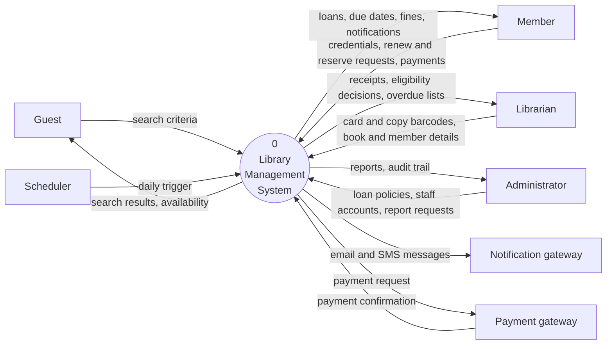

#### Level-1 data flow diagram

Level 1 opens the system into its main processes (circles) and data stores (cylinders). Data stores D1 to D6 correspond to the tables in Figure 5.1.

**Figure 5.3: Level-1 data flow diagram**

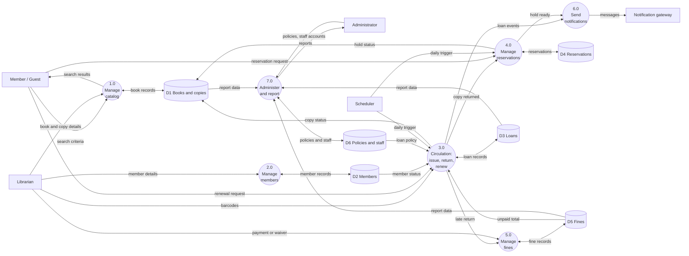

#### Functional decomposition

**Figure 5.4: Functional decomposition**

```mermaid
mindmap
  root((Library Management System))
    Catalog
      Search catalog
      View book details
      Add or update titles
      Add or withdraw copies
    Members
      Register member
      Update details
      Suspend or reinstate
    Circulation
      Issue book
        Verify eligibility
        Calculate due date
      Return book
        Close loan
        Calculate fine
        Shelve or hold copy
      Renew loan
      Detect overdue loans
    Reservations
      Place reservation
      Hold returned copy
      Cancel reservation
      Expire uncollected holds
    Fines
      Record fine
      Take payment
      Waive fine
    Notifications
      Loan receipt
      Due date reminder
      Overdue notice
      Hold ready notice
    Administration
      Staff accounts
      Loan policies
      Reports
      Audit trail
```

#### Process specifications

Each key function in input-process-output (IPO) form:

| Function | Input | Processing | Output |
|---|---|---|---|
| **F1 Search catalog** | Criteria: any of title, author, ISBN, category | Require at least one criterion. Match all given criteria, ignoring case (ISBN must match exactly, ignoring hyphens). Count available copies per match. | List of `{ title, authors, availableCopies, totalCopies }` |
| **F2 Issue book** | `memberId`, `barcode`, `now` | Load the member, copy, active loans, and unpaid fines. Apply BR-01, BR-06, BR-08 and the member's status. Move the copy to `ISSUED`. Create a loan with `dueDate = now + loanPeriodDays`. Fulfil the reservation if the copy was held for this member. | Loan receipt, or a refusal with the reason |
| **F3 Return book** | `barcode`, `now`, condition | Find the active loan. Close it. Move the copy to `RETURNED`. Fee = days late × daily rate, capped (BR-12). If damaged, send the copy for repair; else hold it for the next reservation or shelve it. | Return receipt `{ loan, fine or none, copy status }` |
| **F4 Renew loan** | `loanId`, `now` | Refuse if the membership is not active, the loan is overdue, the loan is at its renewal limit, or the title is reserved (BR-09). Otherwise set `dueDate = now + loanPeriodDays` and add one to the renewal count. | New due date, or a refusal with the reason |
| **F5 Detect overdue loans** | `asOf` | For each active loan with `dueDate < asOf`: if no notice has been sent, send one and record it. | List of overdue loans; notifications |
| **F6 Calculate fine** | Loan, policy, return date | `daysLate = ceil((returnedAt − dueDate) / 1 day)`, at least 0. `amount = min(daysLate × finePerDayCents, maxFinePerLoanCents)`. | Amount in cents |
| **F7 Expire holds** | `now` | For each `READY` reservation with `expiresAt < now`: mark it `EXPIRED`, then hold the copy for the next pending reservation or shelve it. | List of expired reservations; notifications |

### 5.3 Behavioral model

#### Event table

The system is event-driven. *External* events come from actors. *Temporal* events come from the passage of time.

| # | Event | Type | Source | System response | Model element |
|---|---|---|---|---|---|
| E1 | User searches the catalog | External | Guest, Member | Return matching titles with availability | `CatalogService.search` |
| E2 | Copy presented for check-out | External | Librarian | Check eligibility, issue the copy, create a loan, send a receipt | `CirculationService.issueBook` |
| E3 | Copy returned | External | Librarian | Close the loan, record any fine, shelve or hold the copy | `CirculationService.returnBook` |
| E4 | Renewal requested | External | Member | Extend the due date or refuse with a reason | `CirculationService.renewLoan` |
| E5 | Reservation placed | External | Member | Add to the title's queue | `ReservationService.reserve` |
| E6 | Due date is two days away | Temporal | Scheduler | Send a reminder | Daily job (Figure 5.9) |
| E7 | Due date passes | Temporal | Scheduler | Treat the loan as overdue, notify once, block new borrowing | `checkOverdueLoans` (prototype: `checkOverdueTransactions`) |
| E8 | Hold period ends | Temporal | Scheduler | Expire the reservation; pass the copy on or shelve it | `ReservationService.expireHolds` |
| E9 | Fine paid or waived | External | Librarian, Payment gateway | Settle the fine; eligibility is recomputed on the next request | `Fine.pay`, `Fine.waive` |
| E10 | Copy reported lost | External | Member, Librarian | Close the loan as lost, charge a replacement fee | `Loan.reportLost`, `BookCopy.reportLost` |
| E11 | Loan policy changed | External | Administrator | New limits apply to future loans and renewals | `LOAN_POLICY` row |

#### Loan state machine

**Figure 5.5: Loan lifecycle**

```mermaid
stateDiagram-v2
    [*] --> Active : issueBook() / dueDate = issuedAt + loanPeriodDays
    Active --> Active : renew() [renewals left, title not reserved] / dueDate = now + loanPeriodDays
    Active --> Overdue : now passes dueDate / send overdue notice once
    Active --> Returned : close(returnedAt) / no fine
    Overdue --> Returned : close(returnedAt) / fine = days late x daily rate, capped
    Active --> Lost : reportLost() / replacement fee
    Overdue --> Lost : reportLost() / replacement fee
    Returned --> [*]
    Lost --> [*]

    note right of Overdue
        renew() is rejected.
        The member cannot borrow
        more books (BR-08).
    end note
```

In code, *Active* and *Overdue* are not separate stored values. `Loan.statusAt(asOf)` derives them from the due date, so a loan becomes overdue at the right moment without any job having to update it. The daily job only sends the notice.

#### Member account state machine

**Figure 5.6: Member account lifecycle**

```mermaid
stateDiagram-v2
    [*] --> Active : register()
    Active --> Suspended : suspend() [misconduct or repeated late returns]
    Suspended --> Active : reinstate()
    Active --> Expired : membership end date passes
    Expired --> Active : renewMembership()
    Active --> Closed : close() [no active loans, no unpaid fines]
    Expired --> Closed : close() [no active loans, no unpaid fines]
    Closed --> [*]

    note right of Active
        Whether an active member may borrow
        is computed on each request from
        loans, overdue status, and fines.
        It is not a stored state.
    end note
```

#### Reservation state machine

**Figure 5.7: Reservation lifecycle**

```mermaid
stateDiagram-v2
    [*] --> Pending : reserve(bookId) [no copy available]
    Pending --> Ready : copy returned / hold copy, expiresAt = now + 3 days, notify member
    Pending --> Cancelled : cancel()
    Ready --> Fulfilled : issue(copy) to the holder
    Ready --> Expired : now passes expiresAt / pass copy to next member or shelve it
    Ready --> Cancelled : cancel() / pass copy to next member or shelve it
    Fulfilled --> [*]
    Expired --> [*]
    Cancelled --> [*]
```

#### Activity diagram: borrowing a book from start to finish

This activity diagram shows the member's whole journey, across several use cases (UC-01, UC-06, UC-03, UC-09).

**Figure 5.8: Borrow a book (activity)**

```mermaid
flowchart TD
    start(["Start"]) --> search["Member searches the catalog"]
    search --> found{"Title found?"}
    found -- "No" --> refine["Refine the search or request a purchase"]
    refine --> stopNone(["End: nothing borrowed"])
    found -- "Yes" --> avail{"Copy available?"}
    avail -- "No" --> reserve["Place a reservation"]
    reserve --> wait["Wait for the hold-ready notice"]
    wait --> desk
    avail -- "Yes" --> desk["Take the copy to the desk"]
    desk --> scan["Librarian scans the member card and the copy"]
    scan --> elig{"Member eligible?"}
    elig -- "No" --> reason["Show the reason: suspended, at limit, overdue loan, or fines"]
    reason --> resolve{"Can it be resolved now?<br/>For example, pay the fine"}
    resolve -- "Yes" --> pay["Pay the fine"]
    pay --> elig
    resolve -- "No" --> stopRefused(["End: no loan"])
    elig -- "Yes" --> issue["Copy becomes Issued, loan created, due date calculated"]
    issue --> receipt["Send the loan receipt"]
    receipt --> stopDone(["End: member leaves with the book"])
```

#### Activity diagram: the daily scheduler job

**Figure 5.9: Daily job (activity)**

```mermaid
flowchart TD
    start(["Daily trigger at 00:05"]) --> loadLoans["Load all active loans"]
    loadLoans --> past{"Next loan:<br/>due date passed?"}
    past -- "No" --> soon{"Due within 2 days?"}
    soon -- "Yes" --> remind["Send a due-date reminder"]
    soon -- "No" --> moreLoans
    remind --> moreLoans
    past -- "Yes" --> noticed{"Overdue notice<br/>already sent?"}
    noticed -- "No" --> notice["Send the overdue notice and record it"]
    noticed -- "Yes" --> moreLoans
    notice --> moreLoans{"More loans?"}
    moreLoans -- "Yes" --> past
    moreLoans -- "No" --> loadHolds["Load READY reservations"]
    loadHolds --> expired{"Next hold:<br/>pickup deadline passed?"}
    expired -- "Yes" --> release["Expire the reservation, then hold the copy<br/>for the next member or shelve it"]
    expired -- "No" --> moreHolds
    release --> moreHolds{"More holds?"}
    moreHolds -- "Yes" --> expired
    moreHolds -- "No" --> report["Publish the overdue list for librarians"]
    report --> done(["Done"])
```

---

## 6. Abstraction to Implementation

This section shows how the models become code: first the mapping rules, then language-neutral pseudocode for the main algorithms, then TypeScript classes that follow the diagrams.

> [!NOTE]
> All TypeScript in section 6.3 was type-checked with TypeScript 5.9.3 under this repository's strict [`tsconfig.json`](../tsconfig.json) settings, including `exactOptionalPropertyTypes` and `erasableSyntaxOnly`. The example in 6.3.9 and the tests in 6.4 were run with Node.js 24. The code is a proposal for the target design. It is not yet in `src/`.

### 6.1 Mapping rules: from model element to code

| Model element | Code construct | Example |
|---|---|---|
| Class | TypeScript `class` | `Loan`, `BookCopy` |
| Abstract class | `abstract class` | `User`, `Member` |
| Interface, realization | `interface` plus `implements` | `LoanPolicy`, `NotificationObserver` |
| Generalization | `extends` | `Student extends Member` |
| Enumeration | String-literal union type. The project's `erasableSyntaxOnly` setting rules out `enum`. | `CopyStatus`, `LoanStatus` |
| Private attribute (`-`) | `private` field, exposed through a read-only getter | `statusValue` with `get status()` |
| Public read-only attribute | `readonly` property | `readonly barcode` |
| Invariant | Constructor validation and guard clauses that throw | `Fine` rejects non-positive amounts |
| Composition | The whole creates and owns a private collection of parts | `Book.addCopy()` creates each `BookCopy` |
| Association to another aggregate | An id reference, not an object reference | `Loan.memberId`, `Loan.barcode` (the prototype does the same with `BorrowTransaction.userId`) |
| Multiplicity 0..* | `Map` or array | `Book.copies` |
| Multiplicity 0..1 | Nullable field | `Reservation.heldBarcode` |
| State diagram | A transition table plus guarded methods | `ALLOWED_TRANSITIONS` in `BookCopy` |
| Derived state | A computed method or getter, never a stored field | `Loan.statusAt()`, `Book.availableCopies` |
| Use case | A public service method | `CirculationService.issueBook()` |
| Sequence diagram | The order of calls inside that method | `issueBook()` follows Figure 4.8 step by step |
| Business rule | A policy value plus a guard in the owning class | BR-01 in `Member.checkEligibility()` |
| Time event | The scheduler calls a service method with an explicit date | `checkOverdueLoans(asOf)` |

### 6.2 Pseudocode

```text
FUNCTION issueBook(memberId, barcode, now)                    // UC-03, Figure 4.8
    member ← members.findById(memberId)    OR FAIL "Member not found"
    book   ← books.findByBarcode(barcode)  OR FAIL "Unknown barcode"
    copy   ← book.getCopy(barcode)
    active ← loans.findActiveByMember(memberId)

    facts ← { activeLoans:      COUNT(active),
              hasOverdueLoan:   ANY loan IN active WHERE loan.statusAt(now) = OVERDUE,
              unpaidFinesCents: fines.unpaidTotalFor(memberId) }
    result ← member.checkEligibility(facts)                   // BR-01, BR-06, BR-08
    IF NOT result.allowed THEN FAIL result.reason

    BEGIN TRANSACTION
        hold ← reservations.findReadyByBarcode(barcode)
        copy.issue(memberId)                                  // AVAILABLE, or own hold → ISSUED
        IF hold EXISTS THEN hold.fulfil()
        loan ← NEW Loan(nextId, memberId, book.id, barcode, now, member.loanPolicy)
        SAVE loan, book, hold
    COMMIT
    notify(memberId, "Please return by " + loan.dueDate)
    RETURN loan
END FUNCTION


FUNCTION returnBook(barcode, now, condition)                  // UC-04, Figure 4.9
    loan   ← loans.findActiveByBarcode(barcode)  OR FAIL "Copy is not on loan"
    member ← members.findById(loan.memberId)
    copy   ← books.findByBarcode(barcode).getCopy(barcode)

    BEGIN TRANSACTION
        loan.close(now)
        copy.checkIn()                                        // ISSUED → RETURNED
        fee ← MIN(daysLate(loan.dueDate, now) × policy.finePerDay, policy.maxFinePerLoan)
        IF fee > 0 THEN SAVE NEW Fine(loan, member, fee)      // BR-12
        IF condition = DAMAGED THEN
            copy.sendForRepair()                              // RETURNED → UNDER_REPAIR
        ELSE
            next ← reservations.nextPendingFor(copy.bookId)   // oldest first
            IF next EXISTS THEN
                copy.holdFor(next.memberId)                   // RETURNED → RESERVED
                next.markReady(barcode, now + HOLD_DAYS)      // BR-07
                notify(next.memberId, "Ready for pickup")
            ELSE
                copy.shelve()                                 // RETURNED → AVAILABLE
            END IF
        END IF
        SAVE loan, book, next
    COMMIT
    RETURN receipt(loan, fine, copy.status)
END FUNCTION


FUNCTION renewLoan(loanId, now)                               // UC-05
    loan   ← loans.findById(loanId)  OR FAIL "Loan not found"
    member ← members.findById(loan.memberId)
    IF member.status ≠ ACTIVE                         THEN FAIL "Membership not active"
    IF loan.statusAt(now) ≠ ACTIVE                    THEN FAIL "Overdue or closed"     // BR-09
    IF loan.renewCount ≥ policy.maxRenewals           THEN FAIL "Renewal limit reached" // BR-03
    IF reservations.hasPendingFor(loan.bookId)        THEN FAIL "Reserved by another member"
    loan.dueDate    ← now + policy.loanPeriodDays                                       // BR-15
    loan.renewCount ← loan.renewCount + 1
    SAVE loan
END FUNCTION


FUNCTION reserve(memberId, bookId, now)                       // UC-06
    member ← members.findById(memberId)  OR FAIL
    book   ← books.findById(bookId)      OR FAIL
    IF member.status ≠ ACTIVE           THEN FAIL "Membership not active"
    IF book.availableCopies > 0         THEN FAIL "A copy is available. Borrow it instead."
    IF member has a PENDING or READY reservation for book THEN FAIL "Already reserved"  // IC-07
    SAVE NEW Reservation(nextId, memberId, bookId, now)       // status PENDING
END FUNCTION


PROCEDURE dailyJob(today)                                     // Scheduler, Figure 5.9
    FOR EACH loan IN loans.findAllActive()
        IF loan.statusAt(today) = OVERDUE THEN
            IF loan.claimOverdueNotice() THEN notify(loan.memberId, "Overdue")        // BR-14
        ELSE IF calendarDate(loan.dueDate) = calendarDate(today) + 2 days THEN
            notify(loan.memberId, "Due in 2 days")                                    // FR-15
        END IF
    END FOR
    FOR EACH reservation IN reservations WHERE status = READY
        IF reservation.expireIfDue(today) THEN
            copy ← copy with barcode reservation.heldBarcode
            next ← reservations.nextPendingFor(reservation.bookId)
            IF next EXISTS THEN copy.holdFor(next.memberId); next.markReady(...)
            ELSE copy.shelve()
        END IF
    END FOR
END PROCEDURE
```

### 6.3 TypeScript implementation

#### 6.3.1 Proposed file layout

The layout extends the prototype's `models/` and `services/` folders with a `repositories/` folder for the data access layer.

```text
src/
  index.ts                     Presentation: console demo
  models/                      Domain model: no I/O, no framework code
    Book.ts                    changed: a catalog title that owns its copies
    BookCopy.ts                new: physical item with the Figure 4.12 lifecycle
    Loan.ts                    new: evolves BorrowTransaction.ts
    LoanPolicy.ts              new: Strategy interface and defaults
    Member.ts                  new: Member, Student, Teacher
    User.ts                    changed: base class only; UserRole gains staff roles
    Fine.ts, Reservation.ts    new
    Notification.ts            unchanged
    time.ts                    new: date helpers
  repositories/                Data access layer
    Repositories.ts            interfaces
    InMemoryLoanRepository.ts  and one in-memory class per interface
  services/                    Business logic layer
    CirculationService.ts      new
    Notifier.ts                new: one-method interface
    NotificationService.ts     unchanged
    UserFactory.ts             unchanged API
    LibrarySystem.ts           becomes a thin facade over the services
```

#### 6.3.2 `BookCopy`: the state diagram in code

Figure 4.12 is written down as data. Every status change goes through `moveTo()`, so an illegal transition, such as issuing a copy that is already issued, is impossible.

```ts
// src/models/BookCopy.ts
export type CopyStatus =
  | "AVAILABLE"
  | "RESERVED"
  | "ISSUED"
  | "RETURNED"
  | "UNDER_REPAIR"
  | "LOST"
  | "WITHDRAWN";

// Figure 4.12 as data: each state lists the states it may move to.
const ALLOWED_TRANSITIONS: Readonly<Record<CopyStatus, readonly CopyStatus[]>> = {
  AVAILABLE: ["ISSUED", "WITHDRAWN"],
  RESERVED: ["ISSUED", "RESERVED", "AVAILABLE"],
  ISSUED: ["RETURNED", "LOST"],
  RETURNED: ["AVAILABLE", "RESERVED", "UNDER_REPAIR"],
  UNDER_REPAIR: ["RETURNED", "WITHDRAWN"],
  LOST: ["RETURNED", "WITHDRAWN"],
  WITHDRAWN: [],
};

export class BookCopy {
  private statusValue: CopyStatus = "AVAILABLE";
  private heldFor: string | null = null;
  readonly barcode: string;
  readonly bookId: string;
  readonly shelfLocation: string;

  constructor(barcode: string, bookId: string, shelfLocation: string) {
    if (!barcode.trim() || !bookId.trim()) {
      throw new Error("A copy needs a barcode and a book id.");
    }
    this.barcode = barcode;
    this.bookId = bookId;
    this.shelfLocation = shelfLocation;
  }

  get status(): CopyStatus {
    return this.statusValue;
  }

  get heldForMemberId(): string | null {
    return this.heldFor;
  }

  /** Available → Issued, or Reserved → Issued for the member it is held for (BR-10). */
  issue(memberId: string): void {
    if (this.statusValue === "RESERVED" && this.heldFor !== memberId) {
      throw new Error(`Copy ${this.barcode} is on hold for another member.`);
    }
    this.moveTo("ISSUED");
    this.heldFor = null;
  }

  /** The copy arrives at the desk: after a loan, after a repair, or when found. */
  checkIn(): void {
    this.moveTo("RETURNED");
  }

  shelve(): void {
    this.moveTo("AVAILABLE");
    this.heldFor = null;
  }

  holdFor(memberId: string): void {
    this.moveTo("RESERVED");
    this.heldFor = memberId;
  }

  sendForRepair(): void {
    this.moveTo("UNDER_REPAIR");
  }

  reportLost(): void {
    this.moveTo("LOST");
  }

  withdraw(): void {
    this.moveTo("WITHDRAWN");
  }

  private moveTo(next: CopyStatus): void {
    if (!ALLOWED_TRANSITIONS[this.statusValue].includes(next)) {
      throw new Error(
        `Copy ${this.barcode} cannot go from ${this.statusValue} to ${next}.`,
      );
    }
    this.statusValue = next;
  }
}
```

#### 6.3.3 `Book`: a catalog title that owns its copies

The composition in Figure 4.3 shows up here: only `Book` creates copies. `availableCopies` is computed from the copies, replacing the prototype's stored counter, but it keeps the same name so existing callers do not change.

```ts
// src/models/Book.ts
import { BookCopy, type CopyStatus } from "./BookCopy.js";

export interface SearchCriteria {
  readonly title?: string;
  readonly author?: string;
  readonly isbn?: string;
  readonly category?: string;
}

export class Book {
  private readonly copies = new Map<string, BookCopy>();
  readonly id: string;
  readonly isbn: string;
  readonly title: string;
  readonly authors: readonly string[];
  readonly category: string;

  constructor(
    id: string,
    isbn: string,
    title: string,
    authors: readonly string[],
    category: string,
  ) {
    if (!id.trim() || !title.trim() || authors.length === 0) {
      throw new Error("A book needs an id, a title, and at least one author.");
    }
    this.id = id;
    this.isbn = normalizeIsbn(isbn);
    this.title = title;
    this.authors = [...authors];
    this.category = category;
  }

  addCopy(barcode: string, shelfLocation: string): BookCopy {
    if (this.copies.has(barcode)) {
      throw new Error(`Copy ${barcode} already exists.`);
    }
    const copy = new BookCopy(barcode, this.id, shelfLocation);
    this.copies.set(barcode, copy);
    return copy;
  }

  hasCopy(barcode: string): boolean {
    return this.copies.has(barcode);
  }

  getCopy(barcode: string): BookCopy {
    const copy = this.copies.get(barcode);
    if (!copy) {
      throw new Error(`Copy ${barcode} does not belong to "${this.title}".`);
    }
    return copy;
  }

  get totalCopies(): number {
    return this.countCopies((status) => status !== "WITHDRAWN");
  }

  get availableCopies(): number {
    return this.countCopies((status) => status === "AVAILABLE");
  }

  /** True when the book matches every criterion that is given. */
  matches(criteria: SearchCriteria): boolean {
    return (
      contains(this.title, criteria.title) &&
      this.authors.some((author) => contains(author, criteria.author)) &&
      contains(this.category, criteria.category) &&
      (criteria.isbn === undefined || this.isbn === normalizeIsbn(criteria.isbn))
    );
  }

  private countCopies(predicate: (status: CopyStatus) => boolean): number {
    let count = 0;
    for (const copy of this.copies.values()) {
      if (predicate(copy.status)) {
        count += 1;
      }
    }
    return count;
  }
}

function normalizeIsbn(isbn: string): string {
  return isbn.replaceAll("-", "").trim();
}

function contains(value: string, term: string | undefined): boolean {
  return term === undefined || value.toLowerCase().includes(term.trim().toLowerCase());
}
```

#### 6.3.4 `LoanPolicy` and `Member`: Strategy plus eligibility rules

Each member subclass supplies its own policy object. `checkEligibility()` returns a result with a reason instead of a bare boolean, so the desk can show *why* a loan was refused (FR-08).

```ts
// src/models/LoanPolicy.ts
export interface LoanPolicy {
  readonly maxActiveLoans: number;
  readonly loanPeriodDays: number;
  readonly maxRenewals: number;
  readonly finePerDayCents: number;
  readonly maxFinePerLoanCents: number;
  readonly maxUnpaidFinesCents: number;
}

// Default values from BR-01 to BR-06. In production they load from LOAN_POLICY (FR-18).
export class StudentLoanPolicy implements LoanPolicy {
  readonly maxActiveLoans = 3;
  readonly loanPeriodDays = 14;
  readonly maxRenewals = 1;
  readonly finePerDayCents = 50;
  readonly maxFinePerLoanCents = 2_000;
  readonly maxUnpaidFinesCents = 500;
}

export class TeacherLoanPolicy implements LoanPolicy {
  readonly maxActiveLoans = 10;
  readonly loanPeriodDays = 30;
  readonly maxRenewals = 3;
  readonly finePerDayCents = 25;
  readonly maxFinePerLoanCents = 2_000;
  readonly maxUnpaidFinesCents = 1_000;
}
```

```ts
// src/models/Member.ts
import { StudentLoanPolicy, TeacherLoanPolicy, type LoanPolicy } from "./LoanPolicy.js";
import { User } from "./User.js"; // the prototype's base class, with UserRole extended

export type MemberStatus = "ACTIVE" | "SUSPENDED" | "EXPIRED" | "CLOSED";

/** Facts the service layer gathers. The member applies the rules to them. */
export interface BorrowingFacts {
  readonly activeLoans: number;
  readonly hasOverdueLoan: boolean;
  readonly unpaidFinesCents: number;
}

export type Eligibility =
  | { readonly allowed: true }
  | { readonly allowed: false; readonly reason: string };

export abstract class Member extends User {
  private statusValue: MemberStatus = "ACTIVE";
  abstract readonly loanPolicy: LoanPolicy;

  get status(): MemberStatus {
    return this.statusValue;
  }

  checkEligibility(facts: BorrowingFacts): Eligibility {
    const policy = this.loanPolicy;
    if (this.statusValue !== "ACTIVE") {
      return { allowed: false, reason: `The membership is ${this.statusValue.toLowerCase()}.` };
    }
    if (facts.hasOverdueLoan) {
      return { allowed: false, reason: "Overdue books must be returned first." }; // BR-08
    }
    if (facts.activeLoans >= policy.maxActiveLoans) {
      return { allowed: false, reason: `The limit of ${policy.maxActiveLoans} loans is reached.` }; // BR-01
    }
    if (facts.unpaidFinesCents > policy.maxUnpaidFinesCents) {
      return { allowed: false, reason: "Unpaid fines are above the allowed limit." }; // BR-06
    }
    return { allowed: true };
  }

  suspend(): void {
    if (this.statusValue !== "ACTIVE") {
      throw new Error("Only an active member can be suspended.");
    }
    this.statusValue = "SUSPENDED";
  }

  reinstate(): void {
    if (this.statusValue !== "SUSPENDED") {
      throw new Error("Only a suspended member can be reinstated.");
    }
    this.statusValue = "ACTIVE";
  }
}

export class Student extends Member {
  readonly role = "student" as const;
  readonly loanPolicy = new StudentLoanPolicy();

  constructor(id: string, name: string, email: string) {
    super(id, name, email);
  }
}

export class Teacher extends Member {
  readonly role = "teacher" as const;
  readonly loanPolicy = new TeacherLoanPolicy();

  constructor(id: string, name: string, email: string) {
    super(id, name, email);
  }
}
```

The only change to the prototype's [`User.ts`](../src/models/User.ts) is the role type, which gains the staff roles: `export type UserRole = "student" | "teacher" | "librarian" | "administrator";`.

#### 6.3.5 `Loan`: dates, renewals, and fees

`Loan` evolves the prototype's `BorrowTransaction`. Two differences matter. The due date is calculated from the policy instead of being passed in. And *Active* versus *Overdue* is derived from the date (Figure 5.5) instead of being set manually.

```ts
// src/models/time.ts
export const DAY_MS = 24 * 60 * 60 * 1000;

export function addDays(date: Date, days: number): Date {
  return new Date(date.getTime() + days * DAY_MS);
}

/** Whole days from the due date to the return date, rounded up. Never negative. */
export function daysLate(dueDate: Date, returnedAt: Date): number {
  return Math.max(0, Math.ceil((returnedAt.getTime() - dueDate.getTime()) / DAY_MS));
}

export function formatDate(date: Date): string {
  return date.toISOString().slice(0, 10);
}
```

```ts
// src/models/Loan.ts
import type { LoanPolicy } from "./LoanPolicy.js";
import { addDays, daysLate } from "./time.js";

export type LoanStatus = "ACTIVE" | "OVERDUE" | "RETURNED" | "LOST";

export class Loan {
  private dueDateValue: Date;
  private closedAt: Date | null = null;
  private lost = false;
  private renewals = 0;
  private overdueNoticeSent = false;
  readonly id: string;
  readonly memberId: string;
  readonly bookId: string;
  readonly barcode: string;
  readonly issuedAt: Date;

  constructor(
    id: string,
    memberId: string,
    bookId: string,
    barcode: string,
    issuedAt: Date,
    policy: LoanPolicy,
  ) {
    this.id = id;
    this.memberId = memberId;
    this.bookId = bookId;
    this.barcode = barcode;
    this.issuedAt = issuedAt;
    // BR-02: the due date always comes from the policy, never from user input.
    this.dueDateValue = addDays(issuedAt, policy.loanPeriodDays);
  }

  get dueDate(): Date {
    return new Date(this.dueDateValue); // a copy, so callers cannot change it
  }

  get isOpen(): boolean {
    return this.closedAt === null;
  }

  get renewCount(): number {
    return this.renewals;
  }

  /** ACTIVE and OVERDUE are derived from the date, so they are never stale. */
  statusAt(asOf: Date): LoanStatus {
    if (this.lost) {
      return "LOST";
    }
    if (this.closedAt) {
      return "RETURNED";
    }
    return asOf.getTime() > this.dueDateValue.getTime() ? "OVERDUE" : "ACTIVE";
  }

  daysOverdue(asOf: Date): number {
    return daysLate(this.dueDateValue, this.closedAt ?? asOf);
  }

  renew(policy: LoanPolicy, asOf: Date, titleReserved: boolean): void {
    const status = this.statusAt(asOf);
    if (status !== "ACTIVE") {
      throw new Error(`Only an active loan can be renewed. This loan is ${status}.`);
    }
    if (this.renewals >= policy.maxRenewals) {
      throw new Error("The renewal limit is reached.");
    }
    if (titleReserved) {
      throw new Error("Another member has reserved this book.");
    }
    this.renewals += 1;
    this.dueDateValue = addDays(asOf, policy.loanPeriodDays); // BR-15
  }

  close(returnedAt: Date): void {
    if (this.closedAt) {
      throw new Error(`Loan ${this.id} is already closed.`);
    }
    if (returnedAt.getTime() < this.issuedAt.getTime()) {
      throw new Error("The return date cannot be before the issue date.");
    }
    this.closedAt = returnedAt;
  }

  reportLost(at: Date): void {
    this.close(at);
    this.lost = true;
  }

  /** BR-12: days late × daily rate, capped per loan (BR-05). */
  lateFeeCents(policy: LoanPolicy, asOf: Date): number {
    const fee = this.daysOverdue(asOf) * policy.finePerDayCents;
    return Math.min(fee, policy.maxFinePerLoanCents);
  }

  /** BR-14: true only the first time, so the member is told once. */
  claimOverdueNotice(): boolean {
    if (this.overdueNoticeSent) {
      return false;
    }
    this.overdueNoticeSent = true;
    return true;
  }
}
```

#### 6.3.6 `Fine` and `Reservation`

Both follow the same pattern: a private status that changes only through methods that check the current status first.

<details>
<summary>Show <code>Fine.ts</code> and <code>Reservation.ts</code></summary>

```ts
// src/models/Fine.ts
export type FineStatus = "UNPAID" | "PAID" | "WAIVED";

export class Fine {
  private statusValue: FineStatus = "UNPAID";
  private settledAtValue: Date | null = null;
  readonly id: string;
  readonly loanId: string;
  readonly memberId: string;
  readonly amountCents: number;

  constructor(id: string, loanId: string, memberId: string, amountCents: number) {
    if (!Number.isInteger(amountCents) || amountCents <= 0) {
      throw new Error("A fine must be a positive whole number of cents.");
    }
    this.id = id;
    this.loanId = loanId;
    this.memberId = memberId;
    this.amountCents = amountCents;
  }

  get status(): FineStatus {
    return this.statusValue;
  }

  get settledAt(): Date | null {
    return this.settledAtValue;
  }

  pay(at: Date): void {
    this.settle("PAID", at);
  }

  waive(at: Date): void {
    this.settle("WAIVED", at);
  }

  private settle(outcome: "PAID" | "WAIVED", at: Date): void {
    if (this.statusValue !== "UNPAID") {
      throw new Error(`Fine ${this.id} is already ${this.statusValue.toLowerCase()}.`);
    }
    this.statusValue = outcome;
    this.settledAtValue = at;
  }
}
```

```ts
// src/models/Reservation.ts
export type ReservationStatus = "PENDING" | "READY" | "FULFILLED" | "CANCELLED" | "EXPIRED";

export class Reservation {
  private statusValue: ReservationStatus = "PENDING";
  private heldBarcodeValue: string | null = null;
  private expiresAtValue: Date | null = null;
  readonly id: string;
  readonly memberId: string;
  readonly bookId: string;
  readonly createdAt: Date;

  constructor(id: string, memberId: string, bookId: string, createdAt: Date) {
    this.id = id;
    this.memberId = memberId;
    this.bookId = bookId;
    this.createdAt = createdAt;
  }

  get status(): ReservationStatus {
    return this.statusValue;
  }

  get heldBarcode(): string | null {
    return this.heldBarcodeValue;
  }

  get expiresAt(): Date | null {
    return this.expiresAtValue;
  }

  markReady(barcode: string, expiresAt: Date): void {
    this.require("PENDING");
    this.statusValue = "READY";
    this.heldBarcodeValue = barcode;
    this.expiresAtValue = expiresAt;
  }

  fulfil(): void {
    this.require("READY");
    this.statusValue = "FULFILLED";
  }

  cancel(): void {
    this.require("PENDING", "READY");
    this.statusValue = "CANCELLED";
  }

  /** Called by the daily job. True if the hold has just expired. */
  expireIfDue(now: Date): boolean {
    if (
      this.statusValue !== "READY" ||
      this.expiresAtValue === null ||
      now.getTime() <= this.expiresAtValue.getTime()
    ) {
      return false;
    }
    this.statusValue = "EXPIRED";
    return true;
  }

  private require(...allowed: ReservationStatus[]): void {
    if (!allowed.includes(this.statusValue)) {
      throw new Error(
        `Reservation ${this.id} is ${this.statusValue}; expected ${allowed.join(" or ")}.`,
      );
    }
  }
}
```

</details>

#### 6.3.7 Repository interfaces (data access layer)

The interfaces belong to the business layer, and the storage classes implement them (dependency inversion). They are synchronous to match the prototype. A database-backed version would return `Promise`s, and the services would become `async`.

```ts
// src/repositories/Repositories.ts
import type { Book, SearchCriteria } from "../models/Book.js";
import type { Fine } from "../models/Fine.js";
import type { Loan } from "../models/Loan.js";
import type { Member } from "../models/Member.js";
import type { Reservation } from "../models/Reservation.js";

export interface BookRepository {
  findById(bookId: string): Book | undefined;
  findByBarcode(barcode: string): Book | undefined;
  search(criteria: SearchCriteria): Book[];
  save(book: Book): void;
}

export interface MemberRepository {
  findById(memberId: string): Member | undefined;
  save(member: Member): void;
}

export interface LoanRepository {
  nextId(): string;
  findById(loanId: string): Loan | undefined;
  findActiveByMember(memberId: string): Loan[];
  findActiveByBarcode(barcode: string): Loan | undefined;
  findAllActive(): Loan[];
  save(loan: Loan): void;
}

export interface ReservationRepository {
  nextId(): string;
  /** The oldest PENDING reservation for the title: first come, first served. */
  nextPendingFor(bookId: string): Reservation | undefined;
  findReadyByBarcode(barcode: string): Reservation | undefined;
  hasPendingFor(bookId: string): boolean;
  save(reservation: Reservation): void;
}

export interface FineRepository {
  nextId(): string;
  unpaidTotalFor(memberId: string): number;
  save(fine: Fine): void;
}
```

<details>
<summary>Show <code>InMemoryLoanRepository.ts</code>, the storage the prototype keeps inside <code>LibrarySystem</code> today</summary>

```ts
// src/repositories/InMemoryLoanRepository.ts
import type { Loan } from "../models/Loan.js";
import type { LoanRepository } from "./Repositories.js";

export class InMemoryLoanRepository implements LoanRepository {
  private readonly loans = new Map<string, Loan>();
  private sequence = 0;

  nextId(): string {
    return `loan-${++this.sequence}`;
  }

  findById(loanId: string): Loan | undefined {
    return this.loans.get(loanId);
  }

  findActiveByMember(memberId: string): Loan[] {
    return this.active().filter((loan) => loan.memberId === memberId);
  }

  findActiveByBarcode(barcode: string): Loan | undefined {
    return this.active().find((loan) => loan.barcode === barcode);
  }

  findAllActive(): Loan[] {
    return this.active();
  }

  save(loan: Loan): void {
    this.loans.set(loan.id, loan);
  }

  private active(): Loan[] {
    return [...this.loans.values()].filter((loan) => loan.isOpen);
  }
}
```

</details>

#### 6.3.8 `CirculationService`: use cases as methods

Each public method is one use case, and its body follows the matching sequence diagram. The service holds no business rules. It loads objects, asks them to act, and saves them. `Notifier` is a one-method interface. The prototype's `NotificationService` already satisfies it without changes.

```ts
// src/services/Notifier.ts
/** What circulation needs from notifications. The prototype's NotificationService already fits. */
export interface Notifier {
  notify(userId: string, message: string): void;
}
```

```ts
// src/services/CirculationService.ts
import type { Book } from "../models/Book.js";
import type { CopyStatus } from "../models/BookCopy.js";
import { Fine } from "../models/Fine.js";
import { Loan } from "../models/Loan.js";
import type { Member } from "../models/Member.js";
import { addDays, formatDate } from "../models/time.js";
import type {
  BookRepository,
  FineRepository,
  LoanRepository,
  MemberRepository,
  ReservationRepository,
} from "../repositories/Repositories.js";
import type { Notifier } from "./Notifier.js";

const HOLD_DAYS = 3; // BR-07

export interface CirculationDependencies {
  readonly books: BookRepository;
  readonly members: MemberRepository;
  readonly loans: LoanRepository;
  readonly reservations: ReservationRepository;
  readonly fines: FineRepository;
  readonly notifier: Notifier;
}

export type CopyCondition = "GOOD" | "DAMAGED";

export interface ReturnReceipt {
  readonly loan: Loan;
  readonly fine: Fine | null;
  readonly copyStatus: CopyStatus;
}

export class CirculationService {
  private readonly deps: CirculationDependencies;

  constructor(deps: CirculationDependencies) {
    this.deps = deps;
  }

  /** UC-03 Issue book (Figure 4.8). */
  issueBook(memberId: string, barcode: string, now = new Date()): Loan {
    const { books, loans, fines, reservations, notifier } = this.deps;
    const member = this.requireMember(memberId);
    const book = this.requireBookWithCopy(barcode);
    const copy = book.getCopy(barcode);

    const activeLoans = loans.findActiveByMember(memberId);
    const eligibility = member.checkEligibility({
      activeLoans: activeLoans.length,
      hasOverdueLoan: activeLoans.some((loan) => loan.statusAt(now) === "OVERDUE"),
      unpaidFinesCents: fines.unpaidTotalFor(memberId),
    });
    if (!eligibility.allowed) {
      throw new Error(eligibility.reason);
    }

    const hold = reservations.findReadyByBarcode(barcode);
    copy.issue(memberId); // throws unless the copy is AVAILABLE or held for this member
    hold?.fulfil();

    const loan = new Loan(loans.nextId(), memberId, book.id, barcode, now, member.loanPolicy);
    loans.save(loan);
    books.save(book);
    if (hold) {
      reservations.save(hold);
    }

    notifier.notify(
      memberId,
      `You borrowed "${book.title}". Please return it by ${formatDate(loan.dueDate)}.`,
    );
    return loan;
  }

  /** UC-04 Return book (Figure 4.9). */
  returnBook(
    barcode: string,
    now = new Date(),
    condition: CopyCondition = "GOOD",
  ): ReturnReceipt {
    const { books, loans, fines, reservations, notifier } = this.deps;
    const loan = loans.findActiveByBarcode(barcode);
    if (!loan) {
      throw new Error(`Copy ${barcode} is not on loan.`);
    }
    const member = this.requireMember(loan.memberId);
    const book = this.requireBookWithCopy(barcode);
    const copy = book.getCopy(barcode);

    loan.close(now);
    copy.checkIn();

    let fine: Fine | null = null;
    const feeCents = loan.lateFeeCents(member.loanPolicy, now);
    if (feeCents > 0) {
      fine = new Fine(fines.nextId(), loan.id, member.id, feeCents);
      fines.save(fine);
    }

    if (condition === "DAMAGED") {
      copy.sendForRepair();
    } else {
      const next = reservations.nextPendingFor(book.id);
      if (next) {
        const holdUntil = addDays(now, HOLD_DAYS);
        copy.holdFor(next.memberId);
        next.markReady(barcode, holdUntil);
        reservations.save(next);
        notifier.notify(
          next.memberId,
          `"${book.title}" is ready for pickup until ${formatDate(holdUntil)}.`,
        );
      } else {
        copy.shelve();
      }
    }

    loans.save(loan);
    books.save(book);
    return { loan, fine, copyStatus: copy.status };
  }

  /** UC-05 Renew loan. */
  renewLoan(loanId: string, now = new Date()): Loan {
    const { loans, reservations } = this.deps;
    const loan = loans.findById(loanId);
    if (!loan) {
      throw new Error(`Loan ${loanId} was not found.`);
    }
    const member = this.requireMember(loan.memberId);
    if (member.status !== "ACTIVE") {
      throw new Error(`The membership is ${member.status.toLowerCase()}.`);
    }
    loan.renew(member.loanPolicy, now, reservations.hasPendingFor(loan.bookId));
    loans.save(loan);
    return loan;
  }

  /** UC-12 Detect overdue loans: same behavior as the prototype's checkOverdueTransactions(). */
  checkOverdueLoans(asOf = new Date()): Loan[] {
    const { books, loans, notifier } = this.deps;
    const overdue = loans
      .findAllActive()
      .filter((loan) => loan.statusAt(asOf) === "OVERDUE");

    for (const loan of overdue) {
      if (!loan.claimOverdueNotice()) {
        continue; // already told (BR-14)
      }
      const title = books.findById(loan.bookId)?.title ?? loan.bookId;
      notifier.notify(loan.memberId, `The due date for "${title}" has passed.`);
      loans.save(loan);
    }
    return overdue;
  }

  private requireMember(memberId: string): Member {
    const member = this.deps.members.findById(memberId);
    if (!member) {
      throw new Error(`Member ${memberId} was not found.`);
    }
    return member;
  }

  private requireBookWithCopy(barcode: string): Book {
    const book = this.deps.books.findByBarcode(barcode);
    if (!book) {
      throw new Error(`No book has a copy with barcode ${barcode}.`);
    }
    return book;
  }
}
```

> [!IMPORTANT]
> With a real database, the body of each public method runs inside one unit of work (a transaction). If any step throws, for example `copy.issue()` rejecting a held copy, nothing is saved (NFR-03). The prototype gets the same effect in memory by undoing `borrowCopy()` in a `catch` block inside `LibrarySystem.borrowBook()`.

#### 6.3.9 Putting it together

A *composition root* builds the object graph once. This replaces the need for a global Singleton and lets tests build a fresh library each time. The other in-memory repositories follow the same pattern as `InMemoryLoanRepository`.

```ts
// Composition root: build the object graph once, in one place.
const books = new InMemoryBookRepository();
const members = new InMemoryMemberRepository();
const reservations = new InMemoryReservationRepository();
const notifier = new NotificationService();
const circulation = new CirculationService({
  books,
  members,
  loans: new InMemoryLoanRepository(),
  reservations,
  fines: new InMemoryFineRepository(),
  notifier,
});

const amina = new Student("student-001", "Amina Yusuf", "amina@example.com");
const marcus = new Teacher("teacher-001", "Marcus Chen", "marcus@example.com");
for (const member of [amina, marcus]) {
  members.save(member);
  notifier.subscribe(member.id, member);
}

const cleanCode = new Book("book-002", "978-0132350884", "Clean Code", ["Robert C. Martin"], "Software");
cleanCode.addCopy("C-0001", "4B-12");
books.save(cleanCode);

// Amina (student) borrows the only copy. The student policy gives 14 days.
const loan = circulation.issueBook("student-001", "C-0001", new Date("2026-11-23T10:00:00Z"));
console.log(loan.dueDate.toISOString()); // 2026-12-07T10:00:00.000Z

// No copy is left, so Marcus reserves the title (normally through ReservationService.reserve).
reservations.save(
  new Reservation(reservations.nextId(), "teacher-001", "book-002", new Date("2026-11-24T09:00:00Z")),
);

// Amina returns it 3 days late: 3 × 50 cents = 150 cents, and the copy is held for Marcus.
const receipt = circulation.returnBook("C-0001", new Date("2026-12-10T10:00:00Z"));
console.log(receipt.fine?.amountCents, receipt.copyStatus); // 150 RESERVED

// Only Marcus can now borrow it.
circulation.issueBook("teacher-001", "C-0001", new Date("2026-12-11T10:00:00Z"));
console.log(marcus.notifications.map((n) => n.message));
```

Actual output:

```text
2026-12-07T10:00:00.000Z
150 RESERVED
[
  '"Clean Code" is ready for pickup until 2026-12-13.',
  'You borrowed "Clean Code". Please return it by 2027-01-10.'
]
```

This one scenario exercises most of the model: the Strategy (14 days for a student, 30 for a teacher), the copy lifecycle (*Available → Issued → Returned → Reserved → Issued*), fine calculation, the reservation queue, and Observer notifications.

### 6.4 Testing the model

The state transition table (section 4.7) and the business rules give test cases directly: one test per legal transition, one per illegal transition, and one per rule boundary. These tests use `node:test`, like the existing [`test/library-system.test.js`](../test/library-system.test.js). All six pass.

```js
import assert from "node:assert/strict";
import test from "node:test";
import { BookCopy } from "../dist/models/BookCopy.js";
import { Loan } from "../dist/models/Loan.js";
import { StudentLoanPolicy } from "../dist/models/LoanPolicy.js";
import { Student } from "../dist/models/Member.js";

test("a copy follows Available → Issued → Returned → Available", () => {
  const copy = new BookCopy("C-0001", "book-1", "4B-12");
  copy.issue("member-1");
  assert.equal(copy.status, "ISSUED");
  copy.checkIn();
  assert.equal(copy.status, "RETURNED");
  copy.shelve();
  assert.equal(copy.status, "AVAILABLE");
});

test("an issued copy cannot be issued again", () => {
  const copy = new BookCopy("C-0001", "book-1", "4B-12");
  copy.issue("member-1");
  assert.throws(() => copy.issue("member-2"), /cannot go from ISSUED to ISSUED/);
});

test("a held copy can be issued only to its holder", () => {
  const copy = new BookCopy("C-0001", "book-1", "4B-12");
  copy.issue("member-1");
  copy.checkIn();
  copy.holdFor("member-2");
  assert.throws(() => copy.issue("member-3"), /on hold for another member/);
  copy.issue("member-2");
  assert.equal(copy.status, "ISSUED");
});

test("a late return is fined per day and capped", () => {
  const policy = new StudentLoanPolicy();
  const loan = new Loan("loan-1", "m-1", "b-1", "C-0001", new Date("2026-01-01T10:00:00Z"), policy);
  assert.equal(loan.lateFeeCents(policy, new Date("2026-01-15T10:00:00Z")), 0); // on the due date
  assert.equal(loan.lateFeeCents(policy, new Date("2026-01-18T10:00:00Z")), 150); // 3 days late
  assert.equal(loan.lateFeeCents(policy, new Date("2026-06-01T10:00:00Z")), 2_000); // capped
});

test("an overdue loan cannot be renewed", () => {
  const policy = new StudentLoanPolicy();
  const loan = new Loan("loan-1", "m-1", "b-1", "C-0001", new Date("2026-01-01T10:00:00Z"), policy);
  assert.throws(() => loan.renew(policy, new Date("2026-01-20T10:00:00Z"), false), /OVERDUE/);
});

test("a student at the loan limit is refused with a reason", () => {
  const student = new Student("s-1", "Test Student", "s@example.com");
  const result = student.checkEligibility({ activeLoans: 3, hasOverdueLoan: false, unpaidFinesCents: 0 });
  assert.deepEqual(result, { allowed: false, reason: "The limit of 3 loans is reached." });
});
```

### 6.5 From prototype to target design: gap analysis

| Area | As-is (prototype) | To-be (this design) | Change needed |
|---|---|---|---|
| Users | `User` → `Student`, `Teacher`, created by `UserFactory` | A `Member` layer with account status and a `LoanPolicy`; `Librarian` and `Administrator` | Insert `Member` between `User` and its subclasses; extend `UserRole` |
| Books | `Book` with a private `copiesAvailable` counter | `Book` owns `BookCopy` objects, each with a 7-state lifecycle | Replace the counter with copies. Keep the `availableCopies` getter. |
| Loans | `BorrowTransaction`; the caller passes the due date; `markOverdue()` sets a manual flag | `Loan`; the due date comes from the policy; renewals, late fees, and lost copies | Evolve the class. Derive overdue status from the date; tests control time with `asOf`. |
| Business rules | Validation of ids, dates, duplicates, and availability | Plus loan limits, fine threshold, overdue block, renewal rules, and holds | Add `LoanPolicy` and `checkEligibility()` |
| Overdue notices | `checkOverdueTransactions(asOf)` with a once-only guard | `checkOverdueLoans(asOf)` with the same guard | Port as is: the prototype already matches the design |
| Reservations, fines | None | `Reservation`, `Fine`, `ReservationService`, `FineService` | New |
| Search | `getBooks()` returns every book | `CatalogService.search(criteria)` | New |
| Storage | `Map` fields inside `LibrarySystem` | Repository interfaces with in-memory and SQL implementations | Extract |
| Structure | `LibrarySystem` Singleton does everything | A thin facade over focused services, wired in a composition root | Split |
| Presentation | Console demo | REST API plus desk, member, and admin interfaces | New |

**Suggested order of work.** Each step is small and keeps the existing tests passing.

1. **Extract repositories** from `LibrarySystem` without changing behavior. This is a pure refactor.
2. **Add `LoanPolicy` and the `Member` layer.** Calculate due dates from the policy and enforce BR-01, BR-06, and BR-08.
3. **Split `Book` into `Book` and `BookCopy`.** Keep `availableCopies` so callers do not change.
4. **Add `Fine` and `Reservation`** with their services.
5. **Add a clock and the daily scheduler job** for overdue notices, reminders, and hold expiry.
6. **Add the API layer, authentication, and a SQL repository** implementation.

**What to keep from the prototype.** Several choices already match this design: private state behind getters (`copiesAvailable`, `returnedAtValue`), constructor validation, explicit dates for testability (`borrowedAt`, `asOf`), the once-only overdue notice, and the Factory and Observer patterns. One trade-off is worth revisiting. The Singleton means all tests share one library, which is why [`test/library-system.test.js`](../test/library-system.test.js) gives every fixture unique ids. A composition root (section 6.3.9) removes that need.

---

## 7. Design Principles and Patterns Applied

### 7.1 Principles

| Principle | Where it shows in the design |
|---|---|
| **Single responsibility** | `BookCopy` tracks only physical status. `Loan` tracks only dates, renewals, and fees. `Member` decides only eligibility. `CirculationService` only orchestrates. Repositories only store. `NotificationService` only delivers. |
| **Encapsulation** | All mutable state is private (`statusValue`, `closedAt`, `copiesAvailable`). It changes only through methods named for real actions (`issue`, `checkIn`, `renew`) that enforce invariants. Getters return copies (`dueDate`, `notifications`), so callers cannot change internal state. |
| **Open/closed** | A new member type, such as alumni, needs a new subclass and policy. `CirculationService` does not change. |
| **Liskov substitution** | Any `Member` subtype works wherever a `Member` is expected. Subclasses supply policy values and never weaken the checks. |
| **Interface segregation** | One small repository interface per aggregate. `Notifier` has one method, so circulation does not depend on `subscribe()`. |
| **Dependency inversion** | Services depend on interfaces (`LoanRepository`, `Notifier`) passed in through the constructor, not on concrete storage. |
| **Information expert** | Each method sits on the class that owns the data it needs (the verbs table in section 4.1). |
| **Tell, don't ask** | The service calls `copy.issue(memberId)` instead of reading the status, checking it, and setting it. |
| **Derive, don't store** | Overdue status, availability, and eligibility are computed, so they cannot go stale. |

### 7.2 Design patterns

| Pattern | Where | Why |
|---|---|---|
| **Factory** | `UserFactory.createUser()` (prototype) | Hides which subclass to create. Also used to build the right subclass when loading a `MEMBER` row by `member_type`. |
| **Singleton** | `LibrarySystem.getInstance()` (prototype) | One entry point for the demo. Trade-off: shared global state in tests. The target design builds services in a composition root instead. |
| **Observer** | `NotificationService`, `NotificationObserver`, `User.update()` (prototype) | Circulation does not need to know how messages are delivered. |
| **Strategy** | `LoanPolicy` with `StudentLoanPolicy` and `TeacherLoanPolicy` | Rules vary by member type without `if (role === ...)` checks. |
| **Repository** | `BookRepository`, `LoanRepository`, and the others | Hides storage. In-memory and SQL versions are interchangeable. |
| **Facade** | `LibrarySystem` | One simple API over several services for the UI and the demo. |
| **State (table-driven)** | `ALLOWED_TRANSITIONS` in `BookCopy` | The state diagram becomes data, so illegal transitions cannot happen. |
| **Unit of work** | One transaction per use case (proposed) | Changes to a loan, copy, fine, and reservation succeed or fail together. |
| **Value object** | `SearchCriteria`, `Notification`, `Eligibility` | Immutable data without identity. |

---

## 8. Traceability Matrix

Each use case traced to its requirements, rules, classes, diagrams, and the prototype code that implements it today.

| Use case | Requirements | Business rules | Classes and methods | Diagrams | Prototype today |
|---|---|---|---|---|---|
| UC-01 Search catalog | FR-01 | none | `CatalogService.search`, `BookRepository.search`, `Book.matches` | 4.10 | `getBooks()` only |
| UC-03 Issue book | FR-07, FR-08 | BR-01, BR-02, BR-06, BR-08, BR-10 | `CirculationService.issueBook`, `Member.checkEligibility`, `BookCopy.issue`, `Loan` | 4.7, 4.8, 4.12, 5.8 | `borrowBook()` |
| UC-04 Return book | FR-09, FR-12, FR-14 | BR-05, BR-07, BR-12 | `CirculationService.returnBook`, `Loan.close`, `Loan.lateFeeCents`, `BookCopy.checkIn` / `shelve` / `holdFor`, `Fine`, `Reservation.markReady` | 4.7, 4.9, 4.12, 5.5 | `returnBook()` |
| UC-05 Renew loan | FR-10 | BR-03, BR-09, BR-15 | `CirculationService.renewLoan`, `Loan.renew` | 4.7, 5.5 | none |
| UC-06 Reserve book | FR-11, FR-13 | BR-07, IC-07 | `ReservationService.reserve`, `Reservation` | 4.5, 4.7, 5.7 | none |
| UC-09 Pay or waive fine | FR-14 | BR-06 | `FineService`, `Fine.pay`, `Fine.waive` | 4.6, 4.7 | none |
| UC-11 Manage members | FR-04, FR-05 | none | `MemberService`, `UserFactory`, `Member.suspend`, `Member.reinstate` | 4.6, 5.6 | `UserFactory`, `addUser()` |
| UC-12 Detect overdue loans | FR-15, FR-16 | BR-11, BR-14 | `CirculationService.checkOverdueLoans`, `Loan.statusAt`, `Loan.claimOverdueNotice`, `NotificationService` | 4.11, 5.9 | `checkOverdueTransactions()` |
| UC-13 Expire uncollected holds | FR-12, FR-16 | BR-07 | `ReservationService.expireHolds`, `Reservation.expireIfDue` | 5.7, 5.9 | none |
| UC-15 Configure loan policies | FR-18 | BR-01 to BR-07 | `LoanPolicy`, `LOAN_POLICY` table | 4.2, 5.1 | none |

---

## 9. Assumptions, Open Questions, and Future Work

### 9.1 Assumptions

- The library has one branch and one currency. Money is stored as integer cents.
- Members borrow **copies** and reserve **titles**.
- Members are students or teachers. A staff member who borrows books also has a member account.
- Times are stored in UTC. A due date is the issue timestamp plus a whole number of days.
- Notifications are always stored in the app. Email and SMS are sent through the gateway when contact details exist.

### 9.2 Open questions for the library

1. Should loans be due at closing time on the due date, rather than at the exact time of issue?
2. Do fines accrue on days the library is closed?
3. Is the replacement fee for a lost copy a fixed amount or the title's price?
4. Do some item types, such as reference books, need their own loan policies?
5. How long should loan history be kept before it is anonymized (NFR-05)?

### 9.3 Future work

- Multiple branches, with copies located at a branch and transfers between branches.
- Self-checkout kiosks and RFID security gates.
- Digital lending and inter-library loans.
- Reading recommendations based on borrowing history, with the member's consent.
- Asynchronous (`Promise`-based) repositories for a real database.

---

## 10. Appendix: Figure Index

| Figure | Title | Type | Section |
|---|---|---|---|
| 2.1 | Actor hierarchy | UML class diagram (actors) | 2.1 |
| 3.1 | Layered architecture | Architecture diagram | 3.3 |
| 3.2 | Business-layer component interactions | Component diagram | 3.4 |
| 3.3 | Deployment view | Deployment diagram | 3.7 |
| 4.1 | Domain overview | UML class diagram | 4.3 |
| 4.2 | Users, members, and loan policies | UML class diagram | 4.3 |
| 4.3 | Catalog and circulation | UML class diagram | 4.3 |
| 4.4 | Services and data access | UML class diagram | 4.3 |
| 4.5 | Member-facing use cases | UML use case diagram | 4.5 |
| 4.6 | Staff and administration use cases | UML use case diagram | 4.5 |
| 4.7 | Circulation use cases in detail | UML use case diagram | 4.5 |
| 4.8 | Issue book | UML sequence diagram | 4.6 |
| 4.9 | Return book | UML sequence diagram | 4.6 |
| 4.10 | Search catalog | UML sequence diagram | 4.6 |
| 4.11 | Detect overdue loans (prototype) | UML sequence diagram | 4.6 |
| 4.12 | BookCopy lifecycle | UML state diagram | 4.7 |
| 4.13 | Book (title) availability (prototype) | UML state diagram | 4.7 |
| 5.1 | Logical data model | Entity-relationship diagram | 5.1 |
| 5.2 | Context diagram | Data flow diagram, level 0 | 5.2 |
| 5.3 | Level-1 data flow diagram | Data flow diagram, level 1 | 5.2 |
| 5.4 | Functional decomposition | Mind map | 5.2 |
| 5.5 | Loan lifecycle | UML state diagram | 5.3 |
| 5.6 | Member account lifecycle | UML state diagram | 5.3 |
| 5.7 | Reservation lifecycle | UML state diagram | 5.3 |
| 5.8 | Borrow a book | UML activity diagram | 5.3 |
| 5.9 | Daily scheduler job | UML activity diagram | 5.3 |
